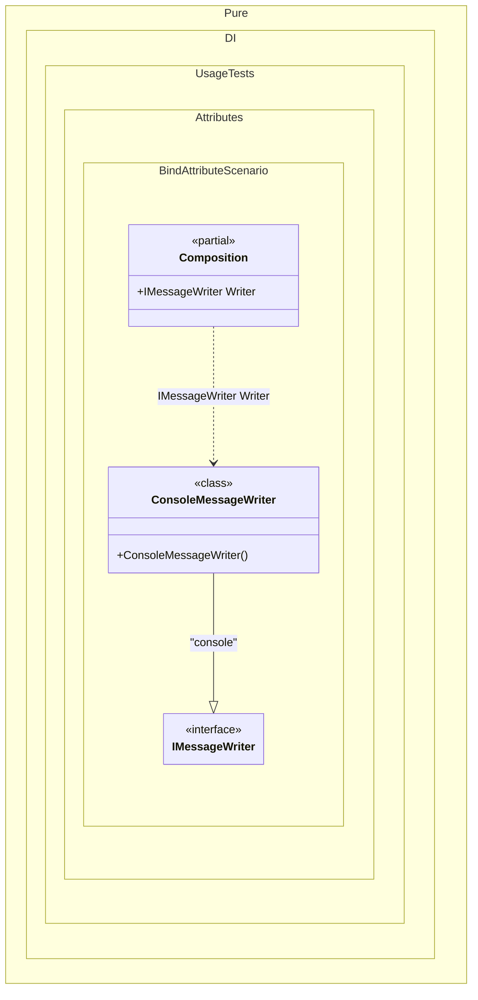

#### Bind attribute

Shows how to declare a binding directly on an implementation type with the built-in `BindAttribute`. The implementation carries its contract, lifetime and tag, and the setup only lists composition roots, so adding a service does not mean editing the composition.


```c#
using Shouldly;
using Pure.DI;

DI.Setup(nameof(Composition))

    // Composition root
    .Root<IMessageWriter>("Writer", "console");

var composition = new Composition();
var writer = composition.Writer;
writer.Write("Pure.DI");

writer.ShouldBeOfType<ConsoleMessageWriter>();
writer.ShouldBeSameAs(composition.Writer);

interface IMessageWriter
{
    void Write(string message);
}

[Bind(typeof(IMessageWriter), Lifetime.Singleton, "console")]
class ConsoleMessageWriter : IMessageWriter
{
    public void Write(string message) => Console.WriteLine(message);
}
```

<details>
<summary>Running this code sample locally</summary>

- Make sure you have the [.NET SDK 10.0](https://dotnet.microsoft.com/en-us/download/dotnet/10.0) or later installed
```bash
dotnet --list-sdk
```
- Create a net10.0 (or later) console application
```bash
dotnet new console -n Sample
```
- Add references to the NuGet packages
  - [Pure.DI](https://www.nuget.org/packages/Pure.DI)
  - [Shouldly](https://www.nuget.org/packages/Shouldly)
```bash
dotnet add package Pure.DI
dotnet add package Shouldly
```
- Copy the example code into the _Program.cs_ file

You are ready to run the example 🚀
```bash
dotnet run
```

</details>

>[!NOTE]
>`BindAttribute` is registered by default and can provide the contract type, lifetime, and tag. Attributes inside the same square-bracket group form one binding; separate `Bind` groups create separate bindings.

The lifetime in the attribute is the same metadata as `.As(Singleton)`, so a reader of `ConsoleMessageWriter` sees that the whole composition shares one instance, and the root assertion in this scenario confirms it. Attribute metadata is read by the generator at compile time and costs nothing at run time.
Because the contract is given as `typeof(IMessageWriter)`, a mistyped contract is a compilation error, and a contract that no binding satisfies is reported while the code is compiled rather than when it runs.
>[!TIP]
>Prefer the setup API for bindings that only one application needs, and attribute bindings for implementations whose DI role is stable across every consumer.

<details>
<summary>The following partial class will be generated</summary>

```c#
partial class Composition
{
#if NET9_0_OR_GREATER
  private readonly Lock _lock = new Lock();
#else
  private readonly Object _lock = new Object();
#endif

  private ConsoleMessageWriter? _singletonConsoleMessageWriter;

  public IMessageWriter Writer
  {
    [MethodImpl(MethodImplOptions.AggressiveInlining)]
    get
    {
      if (_singletonConsoleMessageWriter is null)
        lock (_lock)
          if (_singletonConsoleMessageWriter is null)
          {
            _singletonConsoleMessageWriter = new ConsoleMessageWriter();
          }

      return _singletonConsoleMessageWriter;
    }
  }
}
```

</details>

Class diagram:



See also:

- [Bind type attribute](bind-type-attribute.md)
- [Bind lifetime attribute](bind-lifetime-attribute.md)
- [Bind tag attribute](bind-tag-attribute.md)

