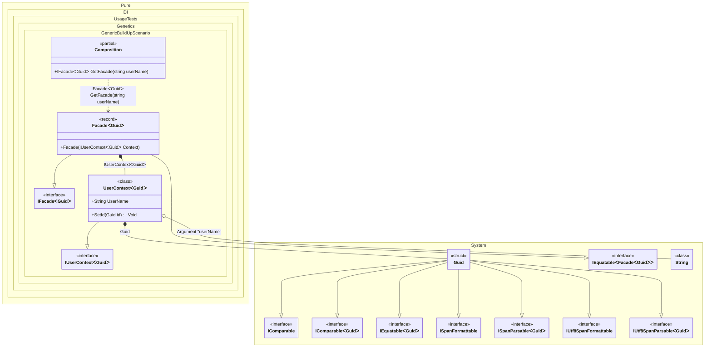

#### Build up of an existing generic object

In other words, injecting the necessary dependencies via methods, properties, or fields into an existing object. `ctx.BuildUp(context)` fills an instance created inside a factory binding, so an object whose constructor cannot express its dependencies still joins the graph.


```c#
using Shouldly;
using Pure.DI;

DI.Setup(nameof(Composition))
    .RootArg<string>("userName")
    .Bind().To(Guid.NewGuid)
    .Bind().To(ctx => {
        // The "BuildUp" method injects dependencies into an existing object.
        // This is useful when the object is created externally (e.g., by a UI framework
        // or an ORM) or requires specific initialization before injection.
        var context = new UserContext<TTS>();
        ctx.BuildUp(context);
        return context;
    })
    .Bind().To<Facade<TTS>>()

    // Composition root
    .Root<IFacade<Guid>>("GetFacade");

var composition = new Composition();
var facade = composition.GetFacade("Erik");

facade.Context.UserName.ShouldBe("Erik");
facade.Context.Id.ShouldNotBe(Guid.Empty);

interface IUserContext<out T>
    where T : struct
{
    string UserName { get; }

    T Id { get; }
}

class UserContext<T> : IUserContext<T>
    where T : struct
{
    // The Dependency attribute specifies to perform an injection
    [Dependency]
    public string UserName { get; set; } = "";

    public T Id { get; private set; }

    // The Dependency attribute specifies to perform an injection
    [Dependency]
    public void SetId(T id) => Id = id;
}

interface IFacade<out T>
    where T : struct
{
    IUserContext<T> Context { get; }
}

record Facade<T>(IUserContext<T> Context)
    : IFacade<T> where T : struct;
```

<details>
<summary>Running this code sample locally</summary>

- Make sure you have the [.NET SDK 10.0](https://dotnet.microsoft.com/en-us/download/dotnet/10.0) or later installed
```bash
dotnet --list-sdk
```
- Create a net10.0 (or later) console application
```bash
dotnet new console -n Sample
```
- Add references to the NuGet packages
  - [Pure.DI](https://www.nuget.org/packages/Pure.DI)
  - [Shouldly](https://www.nuget.org/packages/Shouldly)
```bash
dotnet add package Pure.DI
dotnet add package Shouldly
```
- Copy the example code into the _Program.cs_ file

You are ready to run the example 🚀
```bash
dotnet run
```

</details>

>[!NOTE]
>Generic build-up allows you to inject dependencies into existing generic objects after their creation.

Use it for generic types that a framework constructs - view models, request contexts, entities returned by an object mapper - while the dependencies they declare still come from the composition.
The call runs inside the binding, so the effort is paid on every resolution of that binding, not once. Dependencies injected this way are not owned by the composition, which means an `IDisposable` member stays the caller's responsibility.
>[!NOTE]
>A `[Dependency]` member with no matching binding keeps its initial value instead of failing the build, so a missing injection shows up as a null or default value at run time.

Prefer constructor injection for types the composition creates, and use build-up where the framework owns instantiation. See [Build up of an existing object](build-up-of-an-existing-object.md) for the non-generic case and [Generic builder](generic-builder.md) to expose build-up as a public method.

<details>
<summary>The following partial class will be generated</summary>

```c#
partial class Composition
{
  [MethodImpl(MethodImplOptions.AggressiveInlining)]
  public IFacade<Guid> GetFacade(string userName)
  {
    if (userName is null) throw new ArgumentNullException(nameof(userName));
    UserContext<Guid> transientUserContextGuid;
    // The "BuildUp" method injects dependencies into an existing object.
    // This is useful when the object is created externally (e.g., by a UI framework
    // or an ORM) or requires specific initialization before injection.
    UserContext<Guid> localContext = new UserContext<Guid>();
    Guid transientGuid = Guid.NewGuid();
    localContext.UserName = userName;
    localContext.SetId(transientGuid);
    transientUserContextGuid = localContext;
    return new Facade<Guid>(transientUserContextGuid);
  }
}
```

</details>

Class diagram:



See also:

- [Build up of an existing object](build-up-of-an-existing-object.md)
- [Generic builder](generic-builder.md)

