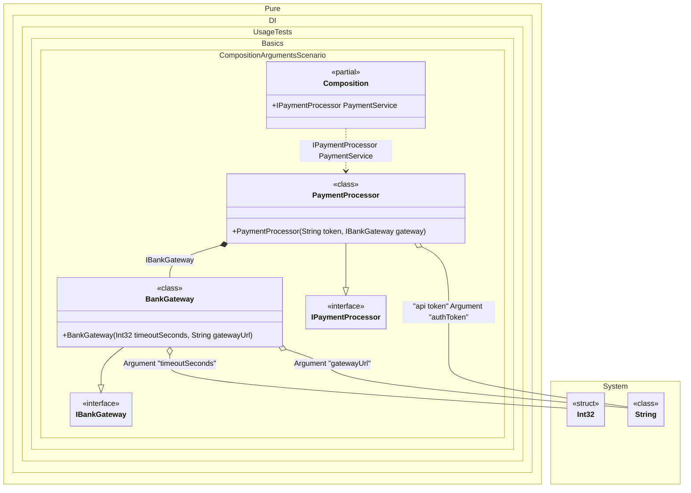

#### Composition arguments

Use composition arguments when the whole graph needs a value from the outside: configuration, a clock, an HTTP client, credentials. Declare them with `Arg<T>(argName)` (optionally with a tag) and use them like any other dependency; only arguments that the object graph actually uses become constructor parameters.
This is the clean way to pass external runtime state without global statics, and it keeps the composition itself testable because the same setup works with different values.
>[!NOTE]
>Actually, composition arguments work like normal bindings. The difference is that they bind to the values of the arguments. These values will be injected wherever they are required.


```c#
using Shouldly;
using Pure.DI;

DI.Setup(nameof(Composition))
    .Bind<IBankGateway>().To<BankGateway>()
    .Bind<IPaymentProcessor>().To<PaymentProcessor>()

    // Composition root "PaymentService"
    .Root<IPaymentProcessor>("PaymentService")

    // Composition argument: Connection timeout (e.g., from config)
    .Arg<int>("timeoutSeconds")

    // Composition argument: API Token (using a tag to distinguish from other strings)
    .Arg<string>("authToken", "api token")

    // Composition argument: Bank gateway address
    .Arg<string>("gatewayUrl");

// Create the composition, passing real settings from outside
var composition = new Composition(
    timeoutSeconds: 30,
    authToken: "secret_token_123",
    gatewayUrl: "https://api.bank.com/v1");

var paymentService = composition.PaymentService;

paymentService.Token.ShouldBe("secret_token_123");
paymentService.Gateway.Timeout.ShouldBe(30);
paymentService.Gateway.Url.ShouldBe("https://api.bank.com/v1");

interface IBankGateway
{
    int Timeout { get; }

    string Url { get; }
}

// Simulation of a bank gateway client
class BankGateway(int timeoutSeconds, string gatewayUrl) : IBankGateway
{
    public int Timeout { get; } = timeoutSeconds;

    public string Url { get; } = gatewayUrl;
}

interface IPaymentProcessor
{
    string Token { get; }

    IBankGateway Gateway { get; }
}

// Payment processing service
class PaymentProcessor(
    // The tag allows specifying exactly which string to inject here
    [Tag("api token")] string token,
    IBankGateway gateway) : IPaymentProcessor
{
    public string Token { get; } = token;

    public IBankGateway Gateway { get; } = gateway;
}
```

<details>
<summary>Running this code sample locally</summary>

- Make sure you have the [.NET SDK 10.0](https://dotnet.microsoft.com/en-us/download/dotnet/10.0) or later installed
```bash
dotnet --list-sdk
```
- Create a net10.0 (or later) console application
```bash
dotnet new console -n Sample
```
- Add references to the NuGet packages
  - [Pure.DI](https://www.nuget.org/packages/Pure.DI)
  - [Shouldly](https://www.nuget.org/packages/Shouldly)
```bash
dotnet add package Pure.DI
dotnet add package Shouldly
```
- Copy the example code into the _Program.cs_ file

You are ready to run the example 🚀
```bash
dotnet run
```

</details>

>[!NOTE]
>Composition arguments provide a way to inject runtime values into the composition, making your DI configuration more flexible.
The argument name is validated as an identifier (`DIE006`) and becomes a named parameter of the composition constructor, so callers read `new Composition(connectionString: ...)` rather than a positional list.
The value is fixed for the lifetime of that composition instance: everything resolved from it shares the same instance, so it behaves like an external immutable value and not like mutable state.
Prefer a root argument when only one entry point needs the value; a composition argument that no graph uses is easy to leave behind after a refactor.
Common pitfalls:
- Using untagged primitive arguments where several values of the same type exist.
- Treating composition arguments as mutable runtime state holders.
See also: [Root arguments](root-arguments.md), [Tags](tags.md).

<details>
<summary>The following partial class will be generated</summary>

```c#
partial class Composition
{
  private readonly int _argTimeoutSeconds;
  private readonly string _argAuthToken;
  private readonly string _argGatewayUrl;

  [OrdinalAttribute(128)]
  public Composition(int timeoutSeconds, string authToken, string gatewayUrl)
  {
    _argTimeoutSeconds = timeoutSeconds;
    _argAuthToken = authToken ?? throw new ArgumentNullException(nameof(authToken));
    _argGatewayUrl = gatewayUrl ?? throw new ArgumentNullException(nameof(gatewayUrl));
  }

  public IPaymentProcessor PaymentService
  {
    [MethodImpl(MethodImplOptions.AggressiveInlining)]
    get
    {
      return new PaymentProcessor(_argAuthToken, new BankGateway(_argTimeoutSeconds, _argGatewayUrl));
    }
  }
}
```

</details>

Class diagram:



See also:

- [Root arguments](root-arguments.md)
- [Overrides](overrides.md)
- [Func with arguments](func-with-arguments.md)

