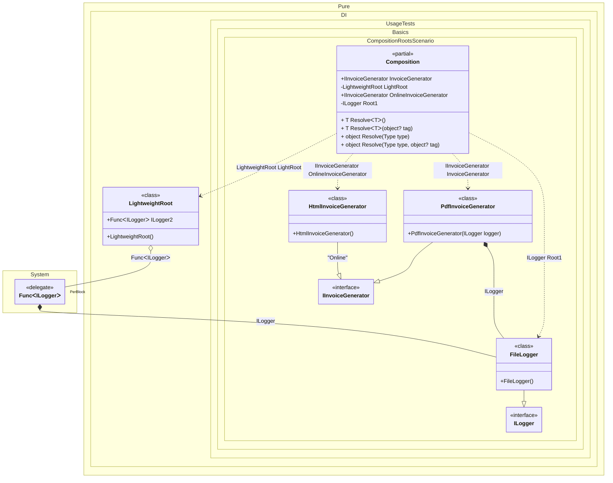

#### Composition roots

A composition root is the explicit entry point into the object graph: `Root<T>(name, tag)` generates a property or a method that creates `T` together with all of its dependencies, so application code never asks the container for a type.
Declare one root per real entry point - a window, a controller, a CLI command, a message handler - and keep everything else private to the composition, so the composition constructor and its roots are the whole public surface of the graph.
Unlike `Resolve<T>()`, a root is an ordinary member: it cannot fail with a missing-root exception, and the compiler knows its exact type, which keeps nullable analysis and refactoring honest.
In classic containers the graph is reached through `T Resolve<T>()` or `object GetService(Type type)`; here every root is generated at compile time, so entry points are explicit and discoverable in the generated code.
>[!TIP]
>There is no hard limit on roots, but prefer a small number. Ideally, an application has a single composition root.


```c#
using Pure.DI;

DI.Setup(nameof(Composition))
    .Bind<IInvoiceGenerator>().To<PdfInvoiceGenerator>()
    .Bind<IInvoiceGenerator>("Online").To<HtmlInvoiceGenerator>()
    .Bind<ILogger>().To<FileLogger>()

    // Specifies to create a regular composition root
    // of type "IInvoiceGenerator" with the name "InvoiceGenerator".
    // This will be the main entry point for invoice generation.
    .Root<IInvoiceGenerator>("InvoiceGenerator")

    // Specifies to create an anonymous composition root
    // that is only accessible from "Resolve()" methods.
    // This is useful for auxiliary types or testing.
    .Root<ILogger>()

    // Specifies to create a regular composition root
    // of type "IInvoiceGenerator" with the name "OnlineInvoiceGenerator"
    // using the "Online" tag to differentiate implementations.
    .Root<IInvoiceGenerator>("OnlineInvoiceGenerator", "Online");

var composition = new Composition();

// Resolves the default invoice generator (PDF) with all its dependencies
// invoiceGenerator = new PdfInvoiceGenerator(new FileLogger());
var invoiceGenerator = composition.InvoiceGenerator;

// Resolves the online invoice generator (HTML)
// onlineInvoiceGenerator = new HtmlInvoiceGenerator();
var onlineInvoiceGenerator = composition.OnlineInvoiceGenerator;

// All and only the roots of the composition
// can be obtained by Resolve method.
// Here we resolve the private root 'ILogger'.
var logger = composition.Resolve<ILogger>();

// We can also resolve tagged roots dynamically if needed
var tagged = composition.Resolve<IInvoiceGenerator>("Online");

// Common logger interface used across the system
interface ILogger;

// Concrete implementation of a logger that writes to a file
class FileLogger : ILogger;

// Abstract definition of an invoice generator
interface IInvoiceGenerator;

// Implementation for generating PDF invoices, dependent on ILogger
class PdfInvoiceGenerator(ILogger logger) : IInvoiceGenerator;

// Implementation for generating HTML invoices for online viewing
class HtmlInvoiceGenerator : IInvoiceGenerator;
```

<details>
<summary>Running this code sample locally</summary>

- Make sure you have the [.NET SDK 10.0](https://dotnet.microsoft.com/en-us/download/dotnet/10.0) or later installed
```bash
dotnet --list-sdk
```
- Create a net10.0 (or later) console application
```bash
dotnet new console -n Sample
```
- Add a reference to the NuGet package
  - [Pure.DI](https://www.nuget.org/packages/Pure.DI)
```bash
dotnet add package Pure.DI
```
- Copy the example code into the _Program.cs_ file

You are ready to run the example 🚀
```bash
dotnet run
```

</details>

The root name becomes a member name, so it follows C# member naming rules; an invalid name is reported as `DIE004` and a duplicate one as `DIE005`.
A root declared without a name is anonymous: it is reachable only from `Resolve` methods, which suits diagnostics and tests rather than production call sites.
A root that consumes at least one root argument becomes a method, and only the arguments its own object graph uses appear in the signature.
`// Resolve = Off` before `Setup` drops the anonymous roots and the untyped API, so keep every entry point as a named root; this also shortens generation.
Prefer `RootBind<T>(name).To<TImpl>()` when a type is both a binding and a root, and `Roots<T>` when the implementations come from the assembly, as in plugin scenarios.
Limitations: too many public roots increase composition API surface and make architecture boundaries harder to track; exposing internal services as roots is the usual way this happens.
See also: [Resolve methods](resolve-methods.md), [Root arguments](root-arguments.md).

<details>
<summary>The following partial class will be generated</summary>

```c#
partial class Composition
{
  public IInvoiceGenerator InvoiceGenerator
  {
    [MethodImpl(MethodImplOptions.AggressiveInlining)]
    get
    {
      return new PdfInvoiceGenerator(new FileLogger());
    }
  }

  public IInvoiceGenerator OnlineInvoiceGenerator
  {
    [MethodImpl(MethodImplOptions.AggressiveInlining)]
    get
    {
      return new HtmlInvoiceGenerator();
    }
  }

  private LightweightRoot LightRoot
  {
    [MethodImpl(MethodImplOptions.AggressiveInlining)]
    get
    {
      Func<ILogger> perBlockFuncILogger = new Func<ILogger>(
      [MethodImpl(MethodImplOptions.AggressiveInlining)]
      () =>
      {
        // Creates a deferred value
        return new FileLogger();
      });
      return new LightweightRoot()
      {
        ILogger2 = perBlockFuncILogger
      };
    }
  }

  private ILogger Root1
  {
    [MethodImpl(MethodImplOptions.AggressiveInlining)]
    get
    {
      return LightRoot.ILogger2();
    }
  }

  [MethodImpl(MethodImplOptions.AggressiveInlining)]
  public T Resolve<T>()
  {
    return Resolver<T>.Value.Resolve(this);
  }

  [MethodImpl(MethodImplOptions.AggressiveInlining)]
  public T Resolve<T>(object? tag)
  {
    return Resolver<T>.Value.ResolveByTag(this, tag);
  }

  [MethodImpl(MethodImplOptions.AggressiveInlining)]
  public object Resolve(Type type)
  {
    #if NETCOREAPP3_0_OR_GREATER
    var index = (int)(_bucketSize * (((uint)type.TypeHandle.GetHashCode()) % 4));
    #else
    var index = (int)(_bucketSize * (((uint)RuntimeHelpers.GetHashCode(type)) % 4));
    #endif
    ref var pair = ref _buckets[index];
    return Object.ReferenceEquals(pair.Key, type) ? pair.Value.Resolve(this) : Resolve(type, index);
  }

  [MethodImpl(MethodImplOptions.NoInlining)]
  private object Resolve(Type type, int index)
  {
    var finish = index + _bucketSize;
    while (++index < finish)
    {
      ref var pair = ref _buckets[index];
      if (Object.ReferenceEquals(pair.Key, type))
      {
        return pair.Value.Resolve(this);
      }
    }

    throw new CannotResolveException($"{CannotResolveMessage} {OfTypeMessage} {type}.", type, null);
  }

  [MethodImpl(MethodImplOptions.AggressiveInlining)]
  public object Resolve(Type type, object? tag)
  {
    #if NETCOREAPP3_0_OR_GREATER
    var index = (int)(_bucketSize * (((uint)type.TypeHandle.GetHashCode()) % 4));
    #else
    var index = (int)(_bucketSize * (((uint)RuntimeHelpers.GetHashCode(type)) % 4));
    #endif
    ref var pair = ref _buckets[index];
    return Object.ReferenceEquals(pair.Key, type) ? pair.Value.ResolveByTag(this, tag) : Resolve(type, tag, index);
  }

  [MethodImpl(MethodImplOptions.NoInlining)]
  private object Resolve(Type type, object? tag, int index)
  {
    var finish = index + _bucketSize;
    while (++index < finish)
    {
      ref var pair = ref _buckets[index];
      if (Object.ReferenceEquals(pair.Key, type))
      {
        return pair.Value.ResolveByTag(this, tag);
      }
    }

    throw new CannotResolveException($"{CannotResolveMessage} \"{tag}\" {OfTypeMessage} {type}.", type, tag);
  }

  private readonly static uint _bucketSize;
  private readonly static Pair<IResolver<Composition, object>>[] _buckets;

  static Composition()
  {
    var valResolver_0000 = new Resolver_0000();
    Resolver<IInvoiceGenerator>.Value = valResolver_0000;
    var valResolver_0001 = new Resolver_0001();
    Resolver<ILogger>.Value = valResolver_0001;
    _buckets = Buckets<IResolver<Composition, object>>.Create(
      4,
      out _bucketSize,
      new Pair<IResolver<Composition, object>>[2]
      {
         new Pair<IResolver<Composition, object>>(typeof(IInvoiceGenerator), valResolver_0000)
        ,new Pair<IResolver<Composition, object>>(typeof(ILogger), valResolver_0001)
      });
  }

  private const string CannotResolveMessage = "Cannot resolve composition root ";
  private const string OfTypeMessage = "of type ";

  private class Resolver<T>: IResolver<Composition, T>
  {
    public static IResolver<Composition, T> Value = new Resolver<T>();

    public virtual T Resolve(Composition composite)
    {
      throw new CannotResolveException($"{CannotResolveMessage}{OfTypeMessage}{typeof(T)}.", typeof(T), null);
    }

    public virtual T ResolveByTag(Composition composite, object tag)
    {
      throw new CannotResolveException($"{CannotResolveMessage}\"{tag}\" {OfTypeMessage}{typeof(T)}.", typeof(T), tag);
    }
  }

  private sealed class Resolver_0000: Resolver<IInvoiceGenerator>
  {
    public override IInvoiceGenerator Resolve(Composition composition)
    {
      return composition.InvoiceGenerator;
    }

    public override IInvoiceGenerator ResolveByTag(Composition composition, object tag)
    {
      switch (tag)
      {
        case "Online":
          return composition.OnlineInvoiceGenerator;

        case null:
          return composition.InvoiceGenerator;

        default:
          return base.ResolveByTag(composition, tag);
      }
    }
  }

  private sealed class Resolver_0001: Resolver<ILogger>
  {
    public override ILogger Resolve(Composition composition)
    {
      return composition.Root1;
    }

    public override ILogger ResolveByTag(Composition composition, object tag)
    {
      switch (tag)
      {
        case null:
          return composition.Root1;

        default:
          return base.ResolveByTag(composition, tag);
      }
    }
  }

  #pragma warning disable CS0649
  private sealed class LightweightRoot: LightweightRoot
  {
    [OrdinalAttribute()] public Func<ILogger> ILogger2;
  }
}
```

</details>

Class diagram:



See also:

- [Root binding](root-binding.md)
- [Roots](roots.md)
- [Composition root kinds](composition-root-kinds.md)

