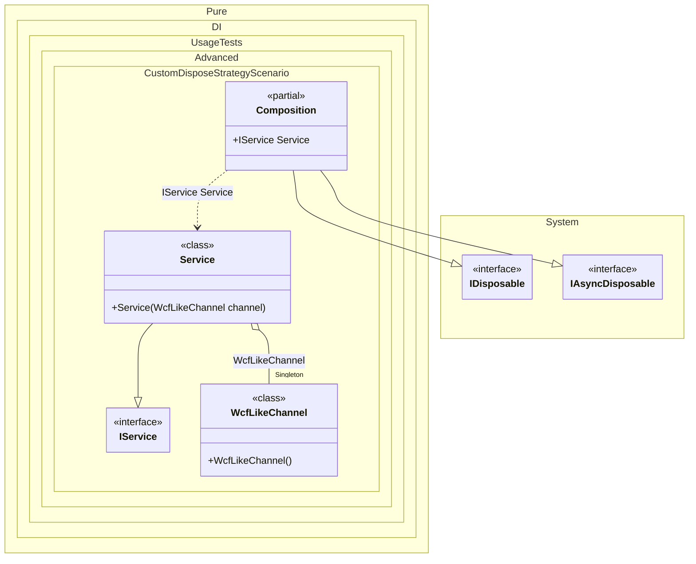

#### Custom dispose strategy

The composition calls `Dispose()` on tracked singleton and scoped instances. Some types — most notably WCF clients that implement `ICommunicationObject` — require a specific shutdown sequence (try `Close()`, fall back to `Abort()` on a timeout or when the channel is faulted). Implement the partial `OnDispose` / `OnDisposeAsync` methods on the composition, perform the custom shutdown logic and return `true` to skip the default disposal call (or `false` to let the composition dispose the instance as usual).


```c#
using Shouldly;
using Pure.DI;

var composition = new Composition();
var service = composition.Service;

// Simulate using the service
service.Open();

// Dispose the composition - this triggers our custom dispose strategy
composition.Dispose();

// The custom disposal strategy ensured the channel was properly closed
service.State.ShouldBe("Closed");

// Simulates a WCF-like client that requires Close-with-timeout and Abort fallback.
class WcfLikeChannel : IDisposable, IAsyncDisposable
{
    public string State { get; private set; } = "Created";

    public void Open() => State = "Opened";

    public void Close(TimeSpan timeout)
    {
        if (State == "Faulted")
        {
            throw new InvalidOperationException("Cannot close a faulted channel.");
        }

        State = "Closed";
    }

    public void Abort() => State = "Aborted";

    public void Dispose() => State = "Disposed";

    public ValueTask DisposeAsync()
    {
        Dispose();
        return ValueTask.CompletedTask;
    }
}

interface IService
{
    string State { get; }

    void Open();
}

class Service(WcfLikeChannel channel) : IService
{
    public string State => channel.State;

    public void Open() => channel.Open();
}

partial class Composition
{
    static void Setup() =>

        DI.Setup()
            .Hint(Hint.OnDispose, "On")
            .Hint(Hint.OnDisposeAsync, "On")
            .Bind().As(Lifetime.Singleton).To<WcfLikeChannel>()
            .Bind().To<Service>()
            .Root<IService>("Service");

    // Custom dispose strategy: wrap each tracked WcfLikeChannel instance
    // in a "SafeClose" helper that performs Close(timeout) -> Abort() fallback.
    // Returns true to tell the composition to skip the default Dispose() / DisposeAsync()
    // call because the hook has already released the resource.
    private partial bool OnDispose<T>(in T disposableInstance)
        where T : IDisposable
    {
        if (disposableInstance is WcfLikeChannel channel)
        {
            SafeShutdown(channel);
            return true;
        }

        return false;
    }

    private partial ValueTask<bool> OnDisposeAsync<T>(in T asyncDisposableInstance)
        where T : IAsyncDisposable
    {
        if (asyncDisposableInstance is WcfLikeChannel channel)
        {
            SafeShutdown(channel);
            return new ValueTask<bool>(true);
        }

        return new ValueTask<bool>(false);
    }

    private static void SafeShutdown(WcfLikeChannel channel)
    {
        if (channel.State == "Opened")
        {
            try
            {
                channel.Close(TimeSpan.FromSeconds(10));
            }
            catch
            {
                channel.Abort();
            }
        }
        else
        {
            channel.Dispose();
        }
    }
}
```

<details>
<summary>Running this code sample locally</summary>

- Make sure you have the [.NET SDK 10.0](https://dotnet.microsoft.com/en-us/download/dotnet/10.0) or later installed
```bash
dotnet --list-sdk
```
- Create a net10.0 (or later) console application
```bash
dotnet new console -n Sample
```
- Add references to the NuGet packages
  - [Pure.DI](https://www.nuget.org/packages/Pure.DI)
  - [Shouldly](https://www.nuget.org/packages/Shouldly)
```bash
dotnet add package Pure.DI
dotnet add package Shouldly
```
- Copy the example code into the _Program.cs_ file

You are ready to run the example 🚀
```bash
dotnet run
```

</details>

>[!IMPORTANT]
>`OnDispose` and `OnDisposeAsync` are partial methods. They are not invoked when not implemented, so there is zero overhead for compositions that do not need a custom disposal strategy.

<details>
<summary>The following partial class will be generated</summary>

```c#
partial class Composition: IDisposable, IAsyncDisposable
{
#if NET9_0_OR_GREATER
  private readonly Lock _lock = new Lock();
#else
  private readonly Object _lock = new Object();
#endif
  private object[] _disposables = new object[1];
  private int _disposeIndex;

  private WcfLikeChannel? _singletonWcfLikeChannel;

  public IService Service
  {
    [MethodImpl(MethodImplOptions.AggressiveInlining)]
    get
    {
      if (_singletonWcfLikeChannel is null)
        lock (_lock)
          if (_singletonWcfLikeChannel is null)
          {
            _singletonWcfLikeChannel = new WcfLikeChannel();
            _disposables[_disposeIndex++] = _singletonWcfLikeChannel;
          }

      return new Service(_singletonWcfLikeChannel);
    }
  }

  private partial bool OnDispose<T>(in T disposableInstance) where T : IDisposable;

  private partial ValueTask<bool> OnDisposeAsync<T>(in T asyncDisposableInstance) where T : IAsyncDisposable;
  public void Dispose()
  {
    int disposeIndex;
    object[] disposables;
    lock (_lock)
    {
      disposeIndex = _disposeIndex;
      _disposeIndex = 0;
      disposables = _disposables;
      _disposables = new object[1];
      _singletonWcfLikeChannel = null;
    }

    while (disposeIndex-- > 0)
    {
      switch (disposables[disposeIndex])
      {
        case IDisposable disposableInstance:
          try
          {
            if (!OnDispose(in disposableInstance))
              disposableInstance.Dispose();
          }
          catch (Exception exception)
          {
            OnDisposeException(disposableInstance, exception);
          }
          break;

        case IAsyncDisposable asyncDisposableInstance:
          try
          {
            if (!OnDisposeAsync(in asyncDisposableInstance).GetAwaiter().GetResult())
              asyncDisposableInstance.DisposeAsync().GetAwaiter().GetResult();
          }
          catch (Exception exception)
          {
            OnDisposeAsyncException(asyncDisposableInstance, exception);
          }
          break;
      }
    }
  }

  partial void OnDisposeException<T>(T disposableInstance, Exception exception) where T : IDisposable;

  partial void OnDisposeAsyncException<T>(T asyncDisposableInstance, Exception exception) where T : IAsyncDisposable;
  public async ValueTask DisposeAsync()
  {
    int disposeIndex;
    object[] disposables;
    {
      disposeIndex = _disposeIndex;
      _disposeIndex = 0;
      disposables = _disposables;
      _disposables = new object[1];
      _singletonWcfLikeChannel = null;
    }

    while (disposeIndex-- > 0)
    {
      switch (disposables[disposeIndex])
      {
        case IAsyncDisposable asyncDisposableInstance:
          try
          {
            if (!await OnDisposeAsync(in asyncDisposableInstance))
              await asyncDisposableInstance.DisposeAsync();
          }
          catch (Exception exception)
          {
            OnDisposeAsyncException(asyncDisposableInstance, exception);
          }
          break;

        case IDisposable disposableInstance:
          try
          {
            if (!OnDispose(in disposableInstance))
              disposableInstance.Dispose();
          }
          catch (Exception exception)
          {
            OnDisposeException(disposableInstance, exception);
          }
          break;
      }
    }
  }
}
```

</details>

Class diagram:



See also:

- [Tracking disposable instances per a composition root](tracking-disposable-instances-per-a-composition-root.md)
- [Custom dispose strategy for Owned<T>](custom-dispose-strategy-for-ownedt.md)

