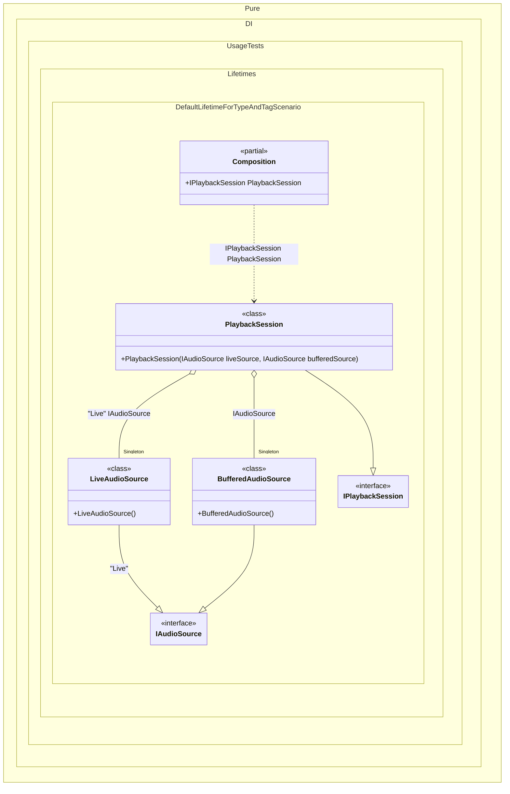

#### Default lifetime for a type and a tag

For example, if a certain lifetime is used more often than others, you can make it the default lifetime for a certain type:
`DefaultLifetime<T>(lifetime, tag)` narrows the rule further: only registrations of `T` with that tag inherit it, so a shared live source and a per-session buffered source can be bound to the same contract and still get different lifetimes.


```c#
using Shouldly;
using Pure.DI;
using static Pure.DI.Lifetime;

DI.Setup(nameof(Composition))
    // Real-world idea:
    // "Live" audio capture device should be shared (singleton),
    // while a regular (untagged) audio source can be created per session (transient).
    .DefaultLifetime<IAudioSource>(Singleton, "Live")

    // Tagged binding: "Live" audio capture (shared)
    .Bind("Live").To<LiveAudioSource>()

    // Untagged binding: some other source (new instance each time)
    .Bind().To<BufferedAudioSource>()

    // A playback session uses two sources:
    // - Live (shared, tagged)
    // - Buffered (transient, untagged)
    .Bind().To<PlaybackSession>()

    // Composition root
    .Root<IPlaybackSession>("PlaybackSession");

var composition = new Composition();

// Two independent sessions (transient root)
var session1 = composition.PlaybackSession;
var session2 = composition.PlaybackSession;

session1.ShouldNotBe(session2);

// Within a single session:
// - Live source is tagged => default lifetime forces it to be shared (singleton)
// - Buffered source is untagged => transient => always a new instance
session1.LiveSource.ShouldNotBe(session1.BufferedSource);

// Between sessions:
// - Live source is a shared singleton (same instance)
// - Buffered source is transient (different instances)
session1.LiveSource.ShouldBe(session2.LiveSource);

interface IAudioSource;

// "Live" device: e.g., microphone/line-in capture.
class LiveAudioSource : IAudioSource;

// "Buffered" source: e.g., decoded audio chunks, per-session pipeline buffer.
class BufferedAudioSource : IAudioSource;

interface IPlaybackSession
{
    IAudioSource LiveSource { get; }

    IAudioSource BufferedSource { get; }
}

class PlaybackSession(
    // Tagged dependency: should be singleton because of DefaultLifetime<IAudioSource>(..., "Live")
    [Tag("Live")] IAudioSource liveSource,

    // Untagged dependency: transient by default
    IAudioSource bufferedSource)
    : IPlaybackSession
{
    public IAudioSource LiveSource { get; } = liveSource;

    public IAudioSource BufferedSource { get; } = bufferedSource;
}
```

<details>
<summary>Running this code sample locally</summary>

- Make sure you have the [.NET SDK 10.0](https://dotnet.microsoft.com/en-us/download/dotnet/10.0) or later installed
```bash
dotnet --list-sdk
```
- Create a net10.0 (or later) console application
```bash
dotnet new console -n Sample
```
- Add references to the NuGet packages
  - [Pure.DI](https://www.nuget.org/packages/Pure.DI)
  - [Shouldly](https://www.nuget.org/packages/Shouldly)
```bash
dotnet add package Pure.DI
dotnet add package Shouldly
```
- Copy the example code into the _Program.cs_ file

You are ready to run the example 🚀
```bash
dotnet run
```

</details>

>[!NOTE]
>Default lifetime configuration reduces boilerplate when the same lifetime is consistently used for specific types.

This is the form to use when one contract has several implementations with different intended lifetimes - a live device that must be shared and a buffered source that belongs to one session. The tag keeps the two rules apart, and neither binding has to repeat `.As(...)`.
The tag must match exactly the tag on the binding and on the injection site, including enum tags and `Tag.Type`. A typo produces a separate binding with the default lifetime rather than an error, so check the generated composition when a shared instance turns out to be transient.
>[!NOTE]
>Prefer this over the untagged [Default lifetime for a type](default-lifetime-for-a-type.md) as soon as one contract is bound more than once.

<details>
<summary>The following partial class will be generated</summary>

```c#
partial class Composition
{
#if NET9_0_OR_GREATER
  private readonly Lock _lock = new Lock();
#else
  private readonly Object _lock = new Object();
#endif

  private LiveAudioSource? _singletonWcfLikeChannel;
  private BufferedAudioSource? _singletonCompositionWithGenericRootsAndArgsInOtherProject;

  public IPlaybackSession PlaybackSession
  {
    [MethodImpl(MethodImplOptions.AggressiveInlining)]
    get
    {
      if (_singletonWcfLikeChannel is null)
        lock (_lock)
          if (_singletonWcfLikeChannel is null)
          {
            _singletonWcfLikeChannel = new LiveAudioSource();
          }

      if (_singletonCompositionWithGenericRootsAndArgsInOtherProject is null)
        lock (_lock)
          if (_singletonCompositionWithGenericRootsAndArgsInOtherProject is null)
          {
            _singletonCompositionWithGenericRootsAndArgsInOtherProject = new BufferedAudioSource();
          }

      return new PlaybackSession(_singletonWcfLikeChannel, _singletonCompositionWithGenericRootsAndArgsInOtherProject);
    }
  }
}
```

</details>

Class diagram:



See also:

- [Default lifetime](default-lifetime.md)
- [Default lifetime for a type](default-lifetime-for-a-type.md)

