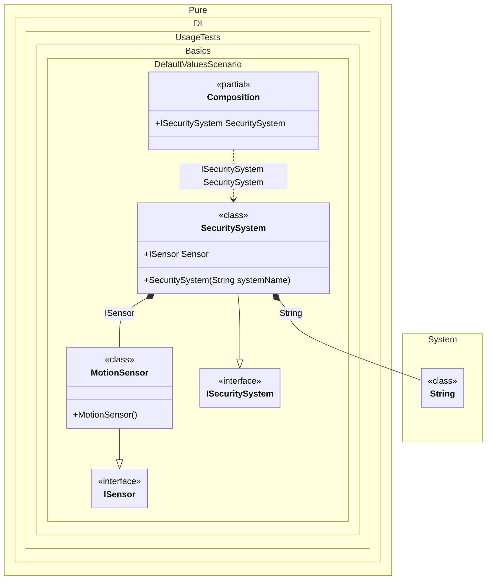

#### Default values

When an injection cannot be satisfied, Pure.DI falls back to the C# default the consumer declared: a constructor parameter default such as `systemName = "Home Guard"`, or a property initializer behind `required`.
This is how an optional dependency and a sensible default value coexist without a separate configuration flag.


```c#
using Shouldly;
using Pure.DI;

DI.Setup(nameof(Composition))
    .Bind<ISensor>().To<MotionSensor>()
    .Bind<ISecuritySystem>().To<SecuritySystem>()

    // Composition root
    .Root<ISecuritySystem>("SecuritySystem");

var composition = new Composition();
var securitySystem = composition.SecuritySystem;
securitySystem.Sensor.ShouldBeOfType<MotionSensor>();
securitySystem.SystemName.ShouldBe("Home Guard");

interface ISensor;

class MotionSensor : ISensor;

interface ISecuritySystem
{
    string SystemName { get; }

    ISensor Sensor { get; }
}

// If injection cannot be performed explicitly,
// the default value will be used
class SecuritySystem(string systemName = "Home Guard") : ISecuritySystem
{
    public string SystemName { get; } = systemName;

    // The 'required' modifier ensures that the property is set during initialization.
    // The default value 'new MotionSensor()' provides a fallback
    // if no dependency is injected.
    public required ISensor Sensor { get; init; } = new MotionSensor();
}
```

<details>
<summary>Running this code sample locally</summary>

- Make sure you have the [.NET SDK 10.0](https://dotnet.microsoft.com/en-us/download/dotnet/10.0) or later installed
```bash
dotnet --list-sdk
```
- Create a net10.0 (or later) console application
```bash
dotnet new console -n Sample
```
- Add references to the NuGet packages
  - [Pure.DI](https://www.nuget.org/packages/Pure.DI)
  - [Shouldly](https://www.nuget.org/packages/Shouldly)
```bash
dotnet add package Pure.DI
dotnet add package Shouldly
```
- Copy the example code into the _Program.cs_ file

You are ready to run the example 🚀
```bash
dotnet run
```

</details>

The fallback applies only where the consumer declared a default; when no binding and no default exist, the graph fails at compile time (`DIE000`), so a default is not a way to ignore a missing binding.
An explicit binding always wins over the declared default, which makes the class usable both as a self-contained entity and as a composed service.
A `required` property with an initializer is assigned by the generated code when a binding exists; the initializer is what the language requires for construction without the member.
Prefer an explicit nullable dependency when absence is a real state, and defaults for configuration-like values such as a name or a timeout.

<details>
<summary>The following partial class will be generated</summary>

```c#
partial class Composition
{
  public ISecuritySystem SecuritySystem
  {
    [MethodImpl(MethodImplOptions.AggressiveInlining)]
    get
    {
      return new SecuritySystem("Home Guard")
      {
        Sensor = new MotionSensor()
      };
    }
  }
}
```

</details>

Class diagram:



See also:

- [Required properties or fields](required-properties-or-fields.md)

