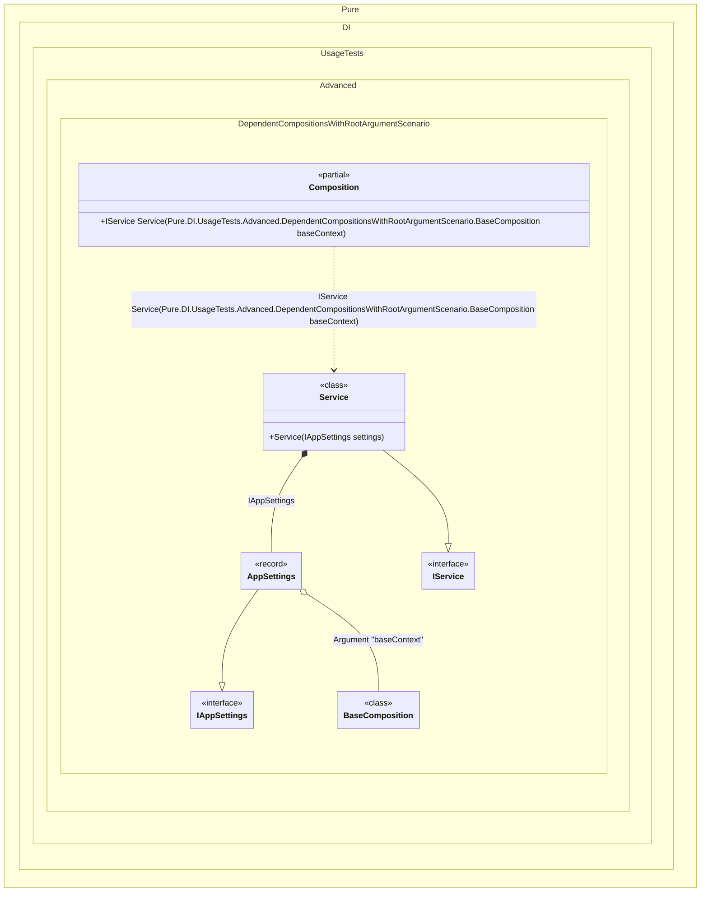

#### Dependent compositions with setup context root argument

This scenario shows how to pass an explicit setup context as a root argument.
When this occurs: you need external state from the base setup but cannot use a constructor (e.g., Unity MonoBehaviour).
What it solves: keeps the dependent composition safe while avoiding constructor arguments.
How it is solved in the example: uses DependsOn(..., SetupContextKind.RootArgument, name) and passes the base setup instance to the root method.
The context is a parameter of the generated root, so one composition instance can serve several calls with different base state.


```c#
using Pure.DI;
using static Pure.DI.CompositionKind;

var baseContext = new BaseComposition { Settings = new AppSettings("staging", 2) };
var composition = new Composition();
var service = composition.Service(baseContext: baseContext);

interface IService
{
    string Report { get; }
}

class Service(IAppSettings settings) : IService
{
    public string Report { get; } = $"env={settings.Environment}, retries={settings.RetryCount}";
}

internal partial class BaseComposition
{
    internal AppSettings Settings { get; set; } = new("", 0);

    private void Setup()
    {
        DI.Setup(nameof(BaseComposition), Internal)
            .Bind<IAppSettings>().To(_ => Settings);
    }
}

internal partial class Composition
{
    private void Setup()
    {
        // Resolve = Off
        DI.Setup(nameof(Composition))
            .DependsOn(nameof(BaseComposition), SetupContextKind.RootArgument, "baseContext")
            .Bind<IService>().To<Service>()
            .Root<IService>("Service");
    }
}

record AppSettings(string Environment, int RetryCount) : IAppSettings;

interface IAppSettings
{
    string Environment { get; }

    int RetryCount { get; }
}
```

<details>
<summary>Running this code sample locally</summary>

- Make sure you have the [.NET SDK 10.0](https://dotnet.microsoft.com/en-us/download/dotnet/10.0) or later installed
```bash
dotnet --list-sdk
```
- Create a net10.0 (or later) console application
```bash
dotnet new console -n Sample
```
- Add a reference to the NuGet package
  - [Pure.DI](https://www.nuget.org/packages/Pure.DI)
```bash
dotnet add package Pure.DI
```
- Copy the example code into the _Program.cs_ file

You are ready to run the example 🚀
```bash
dotnet run
```

</details>

Use this when the base state is only known at the moment of a resolution, for example when a long-lived host creates a short-lived scope per screen or per request.
The composition itself can still be created with a parameterless constructor, so a host that instantiates it by convention keeps working.
The parameter appears on every root of that composition that needs the base setup, which makes the call site explicit about what it passes.
Prefer `SetupContextKind.Argument` ([setup context](dependent-compositions-with-setup-context.md)) when the state is fixed for the composition lifetime, so callers of the roots do not have to thread the context through.

<details>
<summary>The following partial class will be generated</summary>

```c#
partial class Composition
{
  [MethodImpl(MethodImplOptions.AggressiveInlining)]
  public IService Service(BaseComposition baseContext)
  {
    if (baseContext is null) throw new ArgumentNullException(nameof(baseContext));
    AppSettings transientAppSettings;
    BaseComposition localBaseContext = baseContext;
    transientAppSettings = localBaseContext.Settings;
    return new Service(transientAppSettings);
  }
}
```

</details>

Class diagram:



See also:

- [Dependent compositions with setup context](dependent-compositions-with-setup-context.md)

