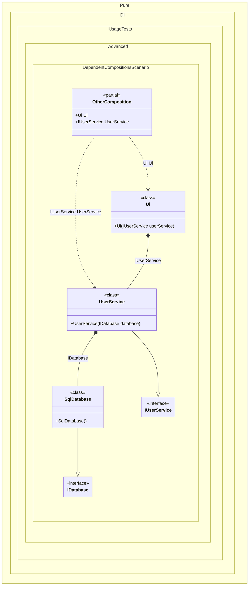

#### Dependent compositions

The `Setup` method has an additional argument `kind`, which defines the type of composition:
- `CompositionKind.Public` - will create a normal composition class, this is the default setting and can be omitted, it can also use the `DependsOn` method to use it as a dependency in other compositions
- `CompositionKind.Internal` - the composition class will not be created, but that composition can be used to create other compositions by calling the `DependsOn` method with its name
- `CompositionKind.Global` - the composition class will also not be created, but that composition will automatically be used to create other compositions
Use dependent compositions to split large object graphs into reusable setup layers.
An `Internal` setup is the right choice for a reusable layer that must not expose a composition class of its own; `Global` is for settings that every composition in the project should inherit, such as hints.
Setups are applied as layers: a setup is applied after every setup it depends on, directly or through a chain of `DependsOn`. A layer that depends on another one and re-binds a contract therefore overrides it, and a composition built on `Composition -> Mid -> Base` gets the binding of `Mid`, exactly as with `.DependsOn("Base", "Mid")`. Among the setups listed in one `DependsOn(...)` call, the later one still overrides the earlier one.


```c#
using Pure.DI;
using static Pure.DI.CompositionKind;

// This setup does not generate code, but can be used as a dependency
// and requires the use of the "DependsOn" call to add it as a dependency
DI.Setup("Infrastructure", Internal)
    .Bind<IDatabase>().To<SqlDatabase>();

// This setup generates code and can also be used as a dependency
DI.Setup(nameof(Composition))
    // Uses "Infrastructure" setup
    .DependsOn("Infrastructure")
    .Bind<IUserService>().To<UserService>()
    .Root<IUserService>("UserService");

// As in the previous case, this setup generates code and can also be used as a dependency
DI.Setup(nameof(OtherComposition))
    // Uses "Composition" setup
    .DependsOn(nameof(Composition))
    .Root<Ui>("Ui");

var composition = new Composition();
var userService = composition.UserService;

var otherComposition = new OtherComposition();
userService = otherComposition.Ui.UserService;

interface IDatabase;

class SqlDatabase : IDatabase;

interface IUserService;

class UserService(IDatabase database) : IUserService;

partial class Ui(IUserService userService)
{
    public IUserService UserService { get; } = userService;
}
```

<details>
<summary>Running this code sample locally</summary>

- Make sure you have the [.NET SDK 10.0](https://dotnet.microsoft.com/en-us/download/dotnet/10.0) or later installed
```bash
dotnet --list-sdk
```
- Create a net10.0 (or later) console application
```bash
dotnet new console -n Sample
```
- Add a reference to the NuGet package
  - [Pure.DI](https://www.nuget.org/packages/Pure.DI)
```bash
dotnet add package Pure.DI
```
- Copy the example code into the _Program.cs_ file

You are ready to run the example 🚀
```bash
dotnet run
```

</details>

This is how a multi-project solution keeps one setup per assembly: each library declares an `Internal` setup, the executable composes them with `.DependsOn("Namespace.Composition")` and exposes named roots.
Setups are matched by name, so use `nameof(Composition)` rather than a string literal to keep `DependsOn` refactor-safe.
A dependent setup contributes its bindings and roots, not its generated members: the composition that declares `DependsOn` owns the generated class and its roots.
Limitations: too many setup layers can make graph ownership unclear; keep boundaries explicit and naming consistent.
Prefer plain class inheritance ([Inheritance of compositions](inheritance-of-compositions.md)) when the layers are in one project and share hand-written members; use `DependsOn` across assemblies and projects.

<details>
<summary>The following partial class will be generated</summary>

```c#
partial class Composition
{
  public IUserService UserService
  {
    [MethodImpl(MethodImplOptions.AggressiveInlining)]
    get
    {
      return new UserService(new SqlDatabase());
    }
  }
}
```

</details>
<details>
<summary>The following partial class will be generated</summary>

```c#
partial class OtherComposition
{
  public IUserService UserService
  {
    [MethodImpl(MethodImplOptions.AggressiveInlining)]
    get
    {
      return new UserService(new SqlDatabase());
    }
  }

  public Ui Ui
  {
    [MethodImpl(MethodImplOptions.AggressiveInlining)]
    get
    {
      return new Ui(new UserService(new SqlDatabase()));
    }
  }
}
```

</details>

Class diagram:



See also:

- [Composition roots](composition-roots.md)
- [Global compositions](global-compositions.md)
- [Inheritance of compositions](inheritance-of-compositions.md)

