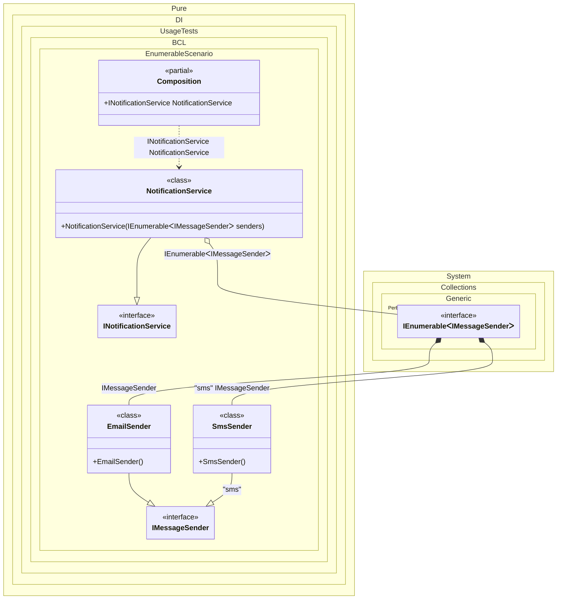

#### Enumerable

Specifying `IEnumerable<T>` as the injection type lets you inject instances of all bindings that implement type `T` in a lazy fashion - the instances will be provided one by one, in order corresponding to the sequence of bindings.


```c#
using Shouldly;
using Pure.DI;
using System.Collections.Immutable;

DI.Setup(nameof(Composition))
    .Bind<IMessageSender>().To<EmailSender>()
    .Bind<IMessageSender>("sms").To<SmsSender>()
    .Bind<INotificationService>().To<NotificationService>()

    // Composition root
    .Root<INotificationService>("NotificationService");

var composition = new Composition();
var notificationService = composition.NotificationService;
notificationService.Senders.Length.ShouldBe(2);
notificationService.Senders[0].ShouldBeOfType<EmailSender>();
notificationService.Senders[1].ShouldBeOfType<SmsSender>();

notificationService.Notify("Hello World");

interface IMessageSender
{
    void Send(string message);
}

class EmailSender : IMessageSender
{
    public void Send(string message)
    {
        // Sending email...
    }
}

class SmsSender : IMessageSender
{
    public void Send(string message)
    {
        // Sending SMS...
    }
}

interface INotificationService
{
    ImmutableArray<IMessageSender> Senders { get; }

    void Notify(string message);
}

class NotificationService(IEnumerable<IMessageSender> senders) : INotificationService
{
    public ImmutableArray<IMessageSender> Senders { get; }
        = [..senders];

    public void Notify(string message)
    {
        foreach (var sender in Senders)
        {
            sender.Send(message);
        }
    }
}
```

<details>
<summary>Running this code sample locally</summary>

- Make sure you have the [.NET SDK 10.0](https://dotnet.microsoft.com/en-us/download/dotnet/10.0) or later installed
```bash
dotnet --list-sdk
```
- Create a net10.0 (or later) console application
```bash
dotnet new console -n Sample
```
- Add references to the NuGet packages
  - [Pure.DI](https://www.nuget.org/packages/Pure.DI)
  - [Shouldly](https://www.nuget.org/packages/Shouldly)
```bash
dotnet add package Pure.DI
dotnet add package Shouldly
```
- Copy the example code into the _Program.cs_ file

You are ready to run the example 🚀
```bash
dotnet run
```

</details>

>[!NOTE]
>IEnumerable<T> provides lazy evaluation, making it efficient for scenarios where you may not need to enumerate all instances.

The sequence is produced by generated code and yields the bindings in declaration order, so `EmailSender` comes before the tagged `SmsSender`. In the scenario the consumer materializes it once into an `ImmutableArray<IMessageSender>`, because iterating a lazily created sequence twice would create transient senders twice.
A collection parameter is not a `Singleton`: with transient bindings every enumeration yields new instances, which is fine for stateless handlers and wrong for anything that accumulates state. Enumerate once at construction, or make the elements `Singleton`.
Adding a binding of the same contract silently changes what every collection consumer sees, even a consumer in another assembly compiled against the composition. Cover the expected order and count with a test.
>[!TIP]
>Prefer `IEnumerable<T>` for a pipeline that may skip elements, and an array or `ImmutableArray<T>` when the elements are read more than once.

<details>
<summary>The following partial class will be generated</summary>

```c#
partial class Composition
{
  public INotificationService NotificationService
  {
    [MethodImpl(MethodImplOptions.AggressiveInlining)]
    get
    {
      [MethodImpl(MethodImplOptions.AggressiveInlining)]
      IEnumerable<IMessageSender> EnumerationOf_perBlockIEnumerableIMessageSender()
      {
        yield return new EmailSender();
        yield return new SmsSender();
      }

      return new NotificationService(EnumerationOf_perBlockIEnumerableIMessageSender());
    }
  }
}
```

</details>

Class diagram:



See also:

- [Array](array.md)
- [Enumerable generics](enumerable-generics.md)
- [Async Enumerable](async-enumerable.md)

