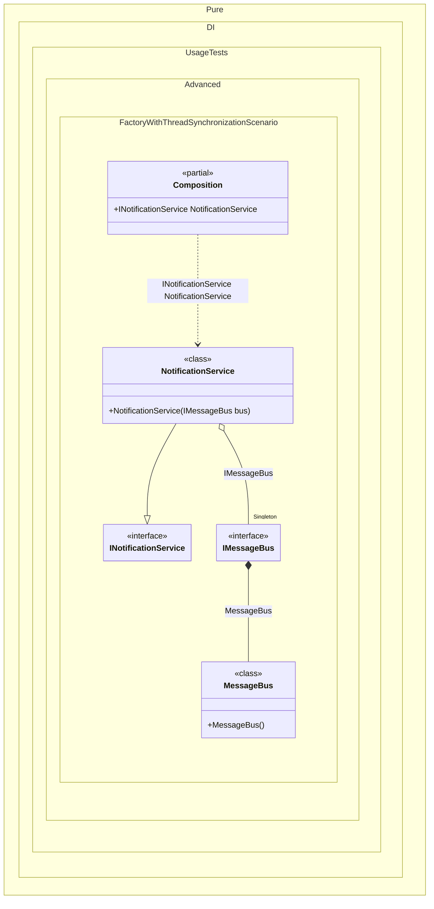

#### Factory with thread synchronization

In some cases, initialization of an object requires synchronization. This scenario demonstrates how to use a factory with thread synchronization to ensure that an object is initialized once and completely.
`ctx.Lock` is the lock of the instance that the factory creates. A singleton, scoped or per-resolve instance is created under this lock, so a custom factory locks the same object instead of introducing a second lock that could deadlock against it.


```c#
using Shouldly;
using Pure.DI;

DI.Setup(nameof(Composition))
    .Bind<IMessageBus>().As(Lifetime.Singleton).To<IMessageBus>(ctx => {
        // Initialization logic requiring synchronization,
        // for example, connecting to a message broker once.
        // ctx.Lock is the lock of this singleton.
        lock (ctx.Lock)
        {
            ctx.Inject(out MessageBus bus);
            bus.Connect();
            return bus;
        }
    })
    .Bind<INotificationService>().To<NotificationService>()

    // Composition root
    .Root<INotificationService>("NotificationService");

var composition = new Composition();
var service = composition.NotificationService;
service.Bus.IsConnected.ShouldBeTrue();

interface IMessageBus
{
    bool IsConnected { get; }
}

class MessageBus : IMessageBus
{
    public bool IsConnected { get; private set; }

    public void Connect() => IsConnected = true;
}

interface INotificationService
{
    IMessageBus Bus { get; }
}

class NotificationService(IMessageBus bus) : INotificationService
{
    public IMessageBus Bus { get; } = bus;
}
```

<details>
<summary>Running this code sample locally</summary>

- Make sure you have the [.NET SDK 11.0](https://dotnet.microsoft.com/en-us/download/dotnet/11.0) or later installed
```bash
dotnet --list-sdk
```
- Create a net11.0 (or later) console application
```bash
dotnet new console -n Sample
```
- Add references to the NuGet packages
  - [Pure.DI](https://www.nuget.org/packages/Pure.DI)
  - [Shouldly](https://www.nuget.org/packages/Shouldly)
```bash
dotnet add package Pure.DI
dotnet add package Shouldly
```
- Copy the example code into the _Program.cs_ file

You are ready to run the example 🚀
```bash
dotnet run
```

</details>

This is for a service that must connect once during construction - a broker connection, a cache warm-up, a first handshake - while other threads may resolve the same graph at the same time.
The lock covers the injection and the initialization together, so no other resolve of the same composition can observe the object half-initialized.
`ctx.Lock` is not a lock of the whole composition: each single instance has its own lock, so creating it waits only for the instances it depends on, and compositions that create the singletons of each other do not deadlock. In a factory of a transient instance, `ctx.Lock` is a lock of that instance, shared by the lambdas the factory creates.
>[!NOTE]
>Thread synchronization in factories should be used carefully as it may impact performance. Only use when necessary for correct initialization behavior.

Prefer `ctx.IsLockRequired` ([IsLockRequired](islockrequired.md)) when the lock should be taken only in thread-safe compositions, and `Hint.ThreadSafe = Off` ([ThreadSafe hint](threadsafe-hint.md)) for a composition that is known to be single-threaded.

<details>
<summary>The following partial class will be generated</summary>

```c#
partial class Composition
{
#if NET9_0_OR_GREATER
  [MethodImpl(MethodImplOptions.AggressiveInlining)]
  private static Lock EnsureLock(ref Lock? lockObject) =>
    lockObject ?? Interlocked.CompareExchange(ref lockObject, new Lock(), null) ?? lockObject!;
#else
  [MethodImpl(MethodImplOptions.AggressiveInlining)]
  private static Object EnsureLock(ref Object? lockObject) =>
    lockObject ?? Interlocked.CompareExchange(ref lockObject, new Object(), null) ?? lockObject!;
#endif

  private IMessageBus? _singletonWcfLikeChannel;
#if NET9_0_OR_GREATER
  private Lock? _singletonWcfLikeChannelLock;
#else
  private Object? _singletonWcfLikeChannelLock;
#endif

  public INotificationService NotificationService
  {
    [MethodImpl(MethodImplOptions.AggressiveInlining)]
    get
    {
      if (_singletonWcfLikeChannel is null)
        lock (EnsureLock(ref _singletonWcfLikeChannelLock))
          if (_singletonWcfLikeChannel is null)
          {
            // Initialization logic requiring synchronization,
            // for example, connecting to a message broker once.
            // ctx.Lock is the lock of this singleton.
            lock (EnsureLock(ref _singletonWcfLikeChannelLock))
            {
              MessageBus localBus = new MessageBus();
              localBus.Connect();
              {
                _singletonWcfLikeChannel = localBus;
                goto _singletonWcfLikeChannelFinish;
              }
            }

            _singletonWcfLikeChannelFinish:
              ;
          }

      return new NotificationService(_singletonWcfLikeChannel);
    }
  }
}
```

</details>

Class diagram:



See also:

- [Factory](factory.md)
- [Thread-safe overrides](thread-safe-overrides.md)

