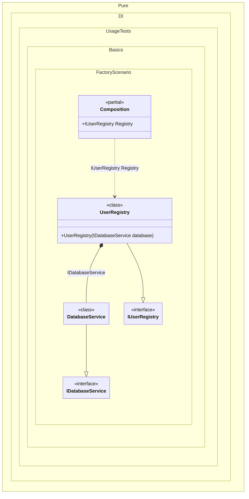

#### Factory

Constructor injection covers most cases, but sometimes an instance needs extra work before it is ready to use - like the `Connect()` call here that opens a database connection.
A factory binding `To<T>(ctx => ...)` puts that creation logic under your control: call `ctx.Inject(out var dependency)` to have the container provide dependencies, run any setup code, then return the finished instance.


```c#
using Shouldly;
using Pure.DI;

DI.Setup(nameof(Composition))
    .Bind<IDatabaseService>().To<DatabaseService>(ctx => {
        // Some logic for creating an instance.
        // For example, we need to manually initialize the connection.
        ctx.Inject(out DatabaseService service);
        service.Connect();
        return service;
    })
    .Bind<IUserRegistry>().To<UserRegistry>()

    // Composition root
    .Root<IUserRegistry>("Registry");

var composition = new Composition();
var registry = composition.Registry;
registry.Database.IsConnected.ShouldBeTrue();

interface IDatabaseService
{
    bool IsConnected { get; }
}

class DatabaseService : IDatabaseService
{
    public bool IsConnected { get; private set; }

    // Simulates a connection establishment that must be called explicitly
    public void Connect() => IsConnected = true;
}

interface IUserRegistry
{
    IDatabaseService Database { get; }
}

class UserRegistry(IDatabaseService database) : IUserRegistry
{
    public IDatabaseService Database { get; } = database;
}
```

<details>
<summary>Running this code sample locally</summary>

- Make sure you have the [.NET SDK 10.0](https://dotnet.microsoft.com/en-us/download/dotnet/10.0) or later installed
```bash
dotnet --list-sdk
```
- Create a net10.0 (or later) console application
```bash
dotnet new console -n Sample
```
- Add references to the NuGet packages
  - [Pure.DI](https://www.nuget.org/packages/Pure.DI)
  - [Shouldly](https://www.nuget.org/packages/Shouldly)
```bash
dotnet add package Pure.DI
dotnet add package Shouldly
```
- Copy the example code into the _Program.cs_ file

You are ready to run the example 🚀
```bash
dotnet run
```

</details>

Fewer surprises come from keeping a factory to what a constructor cannot express: connection setup, registering a callback, setting a property that has no constructor parameter.
The factory runs every time the binding is resolved, so a transient factory means a connection opened per call; give it a lifetime (`As(Lifetime.Singleton)`) when the setup is expensive and meant to happen once.
>[!IMPORTANT]
>The method `Inject()` cannot be used outside of the binding setup.
`ctx.Inject` is synchronous only: async initialization is not supported in a factory (`DIE020`), so move it behind an explicit async method on the service.
Prefer a constructor or a [simplified factory](simplified-factory.md) when the dependencies are all it needs; a factory that only calls `ctx.Inject` for each parameter duplicates a constructor by hand.
See also: [Simplified factory](simplified-factory.md), [Injection on demand](injection-on-demand.md).

<details>
<summary>The following partial class will be generated</summary>

```c#
partial class Composition
{
  public IUserRegistry Registry
  {
    [MethodImpl(MethodImplOptions.AggressiveInlining)]
    get
    {
      DatabaseService transientDatabaseService;
      // Some logic for creating an instance.
      // For example, we need to manually initialize the connection.
      DatabaseService localService = new DatabaseService();
      localService.Connect();
      transientDatabaseService = localService;
      return new UserRegistry(transientDatabaseService);
    }
  }
}
```

</details>

Class diagram:



See also:

- [Simplified factory](simplified-factory.md)
- [Injection on demand](injection-on-demand.md)
- [Overrides](overrides.md)

