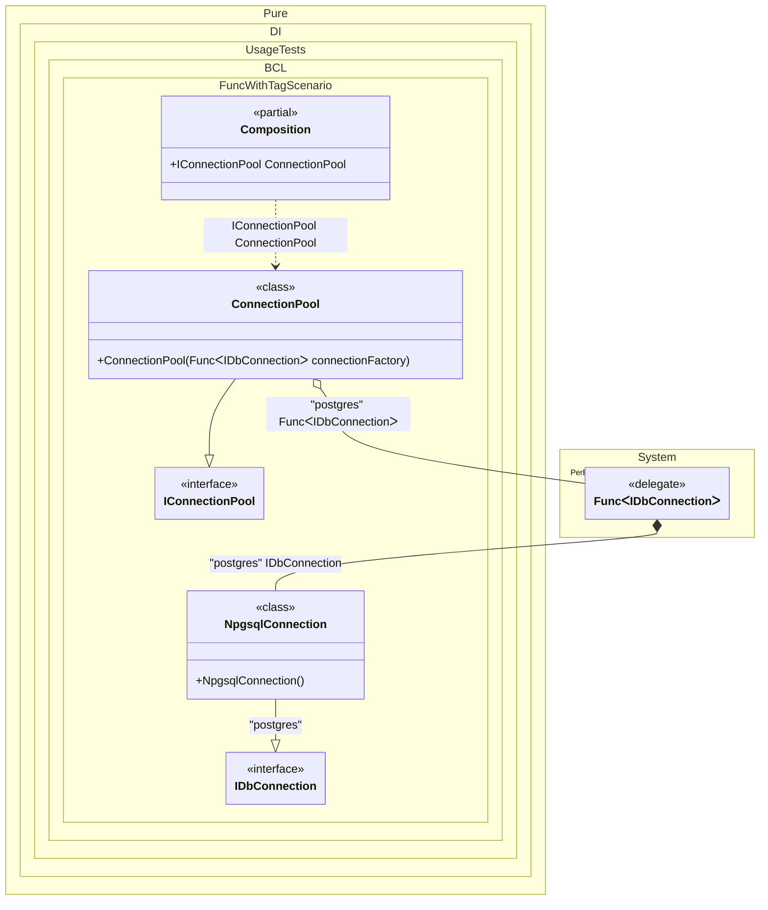

#### Func with tag

A tag applied to a `Func<T>` dependency carries over to the instances it creates. Here `[Tag("postgres")] Func<IDbConnection>` resolves the binding registered with the `"postgres"` tag, and each call returns a new `NpgsqlConnection`, letting the pool create as many distinct connections as it needs.


```c#
using Shouldly;
using Pure.DI;
using System.Collections.Immutable;

DI.Setup(nameof(Composition))
    .Bind<IDbConnection>("postgres").To<NpgsqlConnection>()
    .Bind<IConnectionPool>().To<ConnectionPool>()

    // Composition root
    .Root<IConnectionPool>("ConnectionPool");

var composition = new Composition();
var pool = composition.ConnectionPool;

// Check that the pool has created 3 connections
pool.Connections.Length.ShouldBe(3);
pool.Connections[0].ShouldBeOfType<NpgsqlConnection>();

interface IDbConnection;

// Specific implementation for PostgreSQL
class NpgsqlConnection : IDbConnection;

interface IConnectionPool
{
    ImmutableArray<IDbConnection> Connections { get; }
}

class ConnectionPool([Tag("postgres")] Func<IDbConnection> connectionFactory) : IConnectionPool
{
    public ImmutableArray<IDbConnection> Connections { get; } =
    [
        // Use the factory to create distinct connection instances
        connectionFactory(),
        connectionFactory(),
        connectionFactory()
    ];
}
```

<details>
<summary>Running this code sample locally</summary>

- Make sure you have the [.NET SDK 10.0](https://dotnet.microsoft.com/en-us/download/dotnet/10.0) or later installed
```bash
dotnet --list-sdk
```
- Create a net10.0 (or later) console application
```bash
dotnet new console -n Sample
```
- Add references to the NuGet packages
  - [Pure.DI](https://www.nuget.org/packages/Pure.DI)
  - [Shouldly](https://www.nuget.org/packages/Shouldly)
```bash
dotnet add package Pure.DI
dotnet add package Shouldly
```
- Copy the example code into the _Program.cs_ file

You are ready to run the example 🚀
```bash
dotnet run
```

</details>

>[!NOTE]
>Func with tags allows you to create instances with specific tags dynamically, useful for factory patterns with multiple implementations.

This is what a pool needs: the consumer chooses the implementation by tag once and then creates as many instances as it wants. The tag on the parameter decides which binding the factory creates, so the pool never sees the composition.
The generated instances follow the lifetime of the tagged binding: a transient connection yields a new object per call, while a singleton would yield the same one every time and defeat the pool. Verify the expected count and type in a test, as this scenario does.
>[!TIP]
>Prefer a tagged `Func<T>` over injecting several tagged instances when the number of objects is decided at run time.

<details>
<summary>The following partial class will be generated</summary>

```c#
partial class Composition
{
  public IConnectionPool ConnectionPool
  {
    [MethodImpl(MethodImplOptions.AggressiveInlining)]
    get
    {
      Func<IDbConnection> perBlockFuncIDbConnection = new Func<IDbConnection>(
      [MethodImpl(MethodImplOptions.AggressiveInlining)]
      () =>
      {
        // Creates a deferred value
        return new NpgsqlConnection();
      });
      return new ConnectionPool(perBlockFuncIDbConnection);
    }
  }
}
```

</details>

Class diagram:



See also:

- [Func](func.md)
- [Tags](tags.md)

