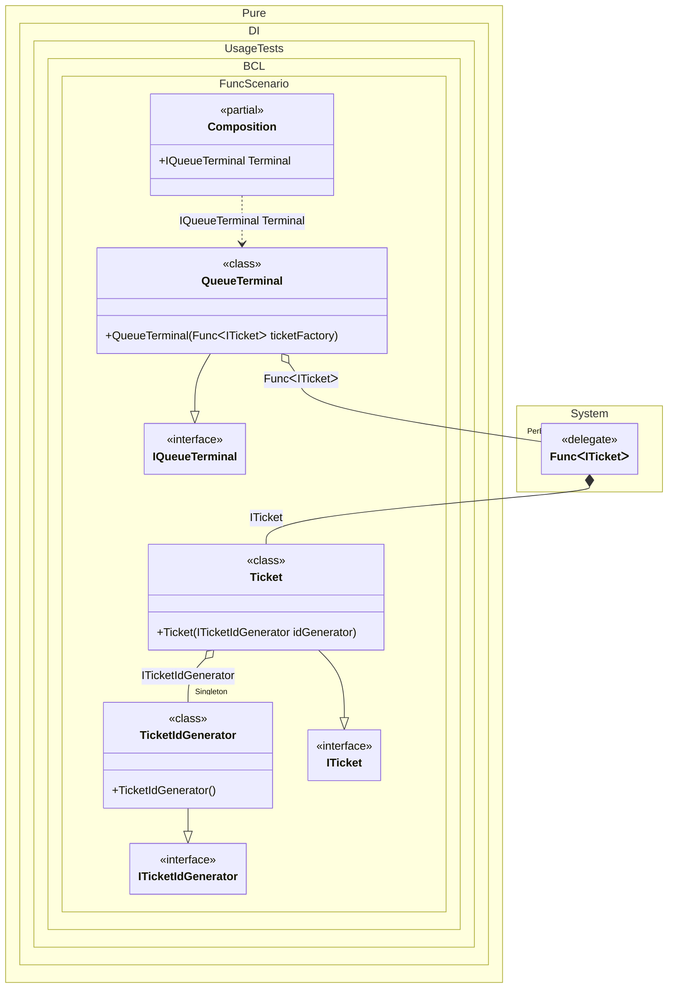

#### Func

_Func<T>_ helps when the logic must enter instances of some type on demand or more than once. This is a very handy mechanism for instance replication. For example it is used when implementing the `Lazy<T>` injection.


```c#
using Shouldly;
using Pure.DI;
using System.Collections.Immutable;

DI.Setup(nameof(Composition))
    .Bind().As(Lifetime.Singleton).To<TicketIdGenerator>()
    .Bind().To<Ticket>()
    .Bind().To<QueueTerminal>()

    // Composition root
    .Root<IQueueTerminal>("Terminal");

var composition = new Composition();
var terminal = composition.Terminal;

terminal.Tickets.Length.ShouldBe(3);

terminal.Tickets[0].Id.ShouldBe(1);
terminal.Tickets[1].Id.ShouldBe(2);
terminal.Tickets[2].Id.ShouldBe(3);

interface ITicketIdGenerator
{
    int NextId { get; }
}

class TicketIdGenerator : ITicketIdGenerator
{
    public int NextId => ++field;
}

interface ITicket
{
    int Id { get; }
}

class Ticket(ITicketIdGenerator idGenerator) : ITicket
{
    public int Id { get; } = idGenerator.NextId;
}

interface IQueueTerminal
{
    ImmutableArray<ITicket> Tickets { get; }
}

class QueueTerminal(Func<ITicket> ticketFactory) : IQueueTerminal
{
    public ImmutableArray<ITicket> Tickets { get; } =
    [
        // The factory creates a new instance of the ticket each time it is called
        ticketFactory(),
        ticketFactory(),
        ticketFactory()
    ];
}
```

<details>
<summary>Running this code sample locally</summary>

- Make sure you have the [.NET SDK 10.0](https://dotnet.microsoft.com/en-us/download/dotnet/10.0) or later installed
```bash
dotnet --list-sdk
```
- Create a net10.0 (or later) console application
```bash
dotnet new console -n Sample
```
- Add references to the NuGet packages
  - [Pure.DI](https://www.nuget.org/packages/Pure.DI)
  - [Shouldly](https://www.nuget.org/packages/Shouldly)
```bash
dotnet add package Pure.DI
dotnet add package Shouldly
```
- Copy the example code into the _Program.cs_ file

You are ready to run the example 🚀
```bash
dotnet run
```

</details>

Be careful, replication takes into account the lifetime of the object. Here `TicketIdGenerator` is a `Singleton`, so the three tickets share one counter and receive ids `1`, `2` and `3`, while each `Ticket` itself is transient.
This is the standard way to hand a consumer the ability to create instances later — a queue terminal, a job factory, a pooled worker — without giving it the container. The delegate is generated code, so the call does not go through reflection.
A `Func<T>` around a `Singleton` returns the same instance on every call, which surprises code that expects fresh objects. Match the lifetime of the requested type to the intent: transient for replication, singleton when the factory is only needed to defer the first use.
>[!TIP]
>Use `Func<T>` for repeated creation and [`Lazy<T>`](lazy.md) when one deferred instance is enough.

<details>
<summary>The following partial class will be generated</summary>

```c#
partial class Composition
{
#if NET9_0_OR_GREATER
  private readonly Lock _lock = new Lock();
#else
  private readonly Object _lock = new Object();
#endif

  private TicketIdGenerator? _singletonWcfLikeChannel;

  public IQueueTerminal Terminal
  {
    [MethodImpl(MethodImplOptions.AggressiveInlining)]
    get
    {
      Func<ITicket> perBlockFuncITicket = new Func<ITicket>(
      [MethodImpl(MethodImplOptions.AggressiveInlining)]
      () =>
      {
        // Creates a deferred value
        if (_singletonWcfLikeChannel is null)
          lock (_lock)
            if (_singletonWcfLikeChannel is null)
            {
              _singletonWcfLikeChannel = new TicketIdGenerator();
            }

        return new Ticket(_singletonWcfLikeChannel);
      });
      return new QueueTerminal(perBlockFuncITicket);
    }
  }
}
```

</details>

Class diagram:



See also:

- [Func with arguments](func-with-arguments.md)
- [Func with tag](func-with-tag.md)
- [Injection on demand](injection-on-demand.md)
- [Lazy](lazy.md)

