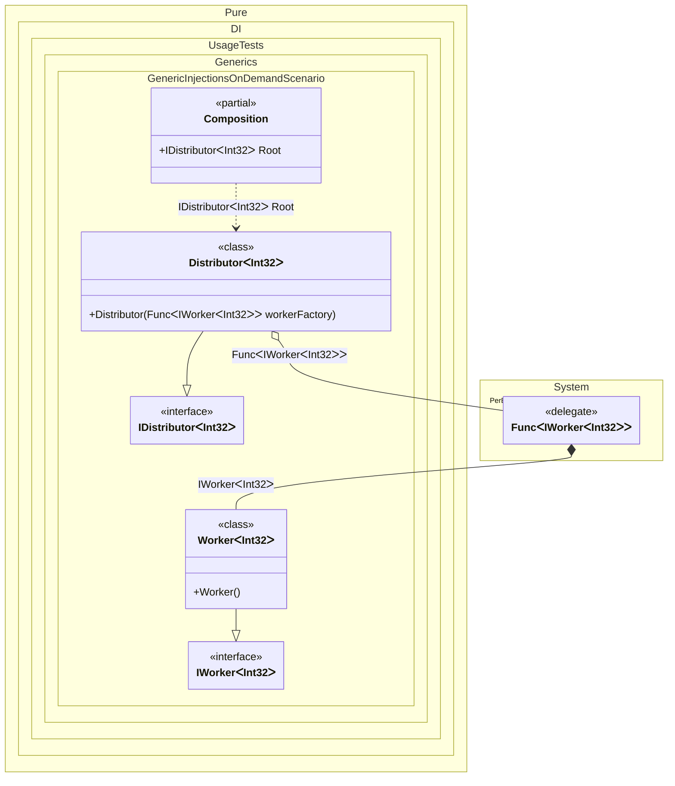

#### Generic injections on demand

On-demand creation via `Func<T>` works inside generic types too. `Distributor<T>` takes a `Func<IWorker<T>>` and calls it whenever it needs another worker — each call produces a new `Worker<T>` for the same type argument.
Use this when the consumer, not the composition, decides how many instances to create and when.


```c#
using Shouldly;
using Pure.DI;
using System.Collections.Generic;

DI.Setup(nameof(Composition))
    .Bind().To<Worker<TT>>()
    .Bind().To<Distributor<TT>>()

    // Composition root
    .Root<IDistributor<int>>("Root");

var composition = new Composition();
var distributor = composition.Root;

// Check that the distributor has created 2 workers
distributor.Workers.Count.ShouldBe(2);

interface IWorker<T>;

class Worker<T> : IWorker<T>;

interface IDistributor<T>
{
    IReadOnlyList<IWorker<T>> Workers { get; }
}

class Distributor<T>(Func<IWorker<T>> workerFactory) : IDistributor<T>
{
    public IReadOnlyList<IWorker<T>> Workers { get; } =
    [
        // Creates the first instance of the worker
        workerFactory(),
        // Creates the second instance of the worker
        workerFactory()
    ];
}
```

<details>
<summary>Running this code sample locally</summary>

- Make sure you have the [.NET SDK 10.0](https://dotnet.microsoft.com/en-us/download/dotnet/10.0) or later installed
```bash
dotnet --list-sdk
```
- Create a net10.0 (or later) console application
```bash
dotnet new console -n Sample
```
- Add references to the NuGet packages
  - [Pure.DI](https://www.nuget.org/packages/Pure.DI)
  - [Shouldly](https://www.nuget.org/packages/Shouldly)
```bash
dotnet add package Pure.DI
dotnet add package Shouldly
```
- Copy the example code into the _Program.cs_ file

You are ready to run the example 🚀
```bash
dotnet run
```

</details>

>[!NOTE]
>Generic on-demand injection provides flexibility for creating instances with different type parameters as needed.

A worker pool, a plugin list or a retry loop that needs as many instances as the data demands uses this shape. The consumer decides the count and the moment, and the factory keeps the graph - and any lifetime attached to it - intact.
Each call is a separate resolution, so `Transient` and `PerResolve` dependencies are new per call while singletons stay shared. That is what makes the factory safe to call in a loop.
>[!NOTE]
>If the factory escapes the composition - stored in a long-lived object or handed to another thread - it keeps the composition reachable. Keep the factory's lifetime inside the scope that owns the consumer.

Prefer this over injecting a collection when the number of instances is decided at run time. Use [Injections on demand with arguments](injections-on-demand-with-arguments.md) when the consumer also supplies per-instance data.

<details>
<summary>The following partial class will be generated</summary>

```c#
partial class Composition
{
  public IDistributor<int> Root
  {
    [MethodImpl(MethodImplOptions.AggressiveInlining)]
    get
    {
      Func<IWorker<int>> perBlockFuncIWorkerInt32 = new Func<IWorker<int>>(
      [MethodImpl(MethodImplOptions.AggressiveInlining)]
      () =>
      {
        // Creates a deferred value
        return new Worker<int>();
      });
      return new Distributor<int>(perBlockFuncIWorkerInt32);
    }
  }
}
```

</details>

Class diagram:



See also:

- [Injection on demand](injection-on-demand.md)
- [Generic injections on demand with arguments](generic-injections-on-demand-with-arguments.md)

