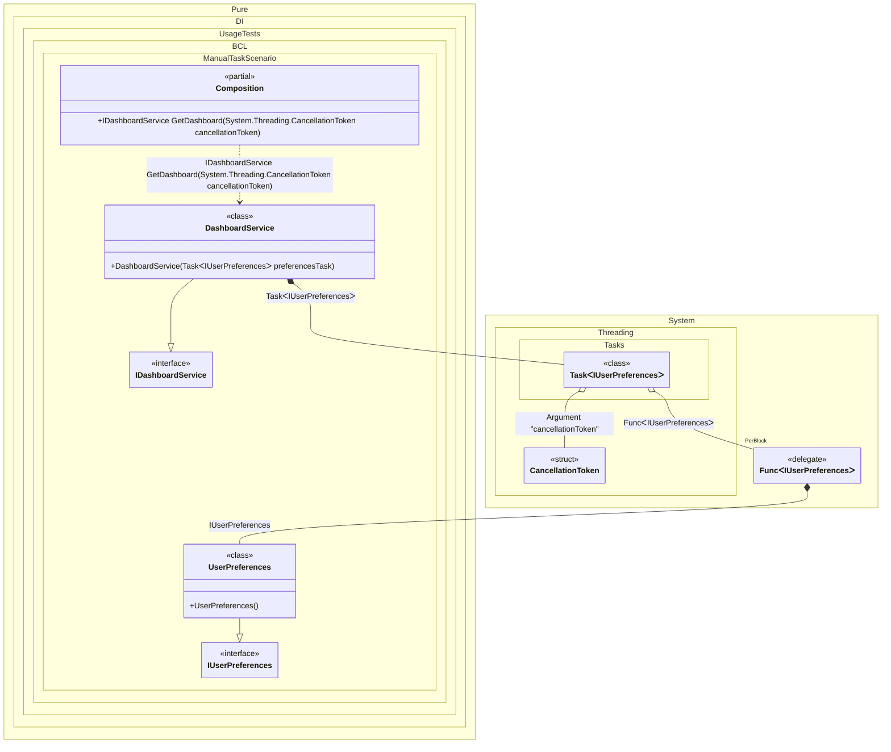

#### Manually started tasks

By default, tasks are started automatically when they are injected. But you can override this behavior as shown in the example below. It is also recommended to add a binding for <c>CancellationToken</c> to be able to cancel the execution of a task.
This is the pattern for a service that wants to start the work itself, for example at an exact moment during its own construction.


```c#
using Pure.DI;

DI.Setup(nameof(Composition))
    // Overrides the default binding that performs an auto-start of a task
    // when it is created. This binding will simply create the task.
    // The start will be handled by the consumer.
    .Bind<Task<TT>>().To(ctx => {
        ctx.Inject(ctx.Tag, out Func<TT> factory);
        ctx.Inject(out CancellationToken cancellationToken);
        return new Task<TT>(factory, cancellationToken);
    })
    // Specifies to use CancellationToken from the composition root argument,
    // if not specified, then CancellationToken.None will be used
    .RootArg<CancellationToken>("cancellationToken")
    .Bind<IUserPreferences>().To<UserPreferences>()
    .Bind<IDashboardService>().To<DashboardService>()

    // Composition root
    .Root<IDashboardService>("GetDashboard");

var composition = new Composition();
using var cancellationTokenSource = new CancellationTokenSource();

// Creates a composition root with the CancellationToken passed to it
var dashboard = composition.GetDashboard(cancellationTokenSource.Token);
await dashboard.LoadAsync(cancellationTokenSource.Token);

interface IUserPreferences
{
    ValueTask LoadAsync(CancellationToken cancellationToken);
}

class UserPreferences : IUserPreferences
{
    public ValueTask LoadAsync(CancellationToken cancellationToken) => ValueTask.CompletedTask;
}

interface IDashboardService
{
    Task LoadAsync(CancellationToken cancellationToken);
}

class DashboardService : IDashboardService
{
    private readonly Task<IUserPreferences> _preferencesTask;

    public DashboardService(Task<IUserPreferences> preferencesTask)
    {
        _preferencesTask = preferencesTask;
        // The task is started manually in the constructor.
        // This allows the loading of preferences to begin immediately in the background,
        // while the service continues its initialization.
        _preferencesTask.Start();
    }

    public async Task LoadAsync(CancellationToken cancellationToken)
    {
        // Wait for the preferences loading task to complete
        var preferences = await _preferencesTask;
        await preferences.LoadAsync(cancellationToken);
    }
}
```

<details>
<summary>Running this code sample locally</summary>

- Make sure you have the [.NET SDK 10.0](https://dotnet.microsoft.com/en-us/download/dotnet/10.0) or later installed
```bash
dotnet --list-sdk
```
- Create a net10.0 (or later) console application
```bash
dotnet new console -n Sample
```
- Add a reference to the NuGet package
  - [Pure.DI](https://www.nuget.org/packages/Pure.DI)
```bash
dotnet add package Pure.DI
```
- Copy the example code into the _Program.cs_ file

You are ready to run the example 🚀
```bash
dotnet run
```

</details>

>[!IMPORTANT]
>The method `Inject()`cannot be used outside of the binding setup.

Overriding `Task<TT>` replaces the default auto-start binding for every task in the composition, so the consumer decides when `Start` is called. Here `DashboardService` starts the task in its constructor and awaits it later in `LoadAsync`, which overlaps loading with the rest of the initialization.
An unstarted task that nobody starts never completes, and `await` on it waits forever: the responsibility moves to the consumer, and that is the trade-off of the override. Keep the override narrow — or use [task](task.md) with automatic start — when only one service needs manual control.
The `CancellationToken` root argument is what makes the task cancellable; without it the binding falls back to `CancellationToken.None` and the manual start cannot be interrupted.

<details>
<summary>The following partial class will be generated</summary>

```c#
partial class Composition
{
  [MethodImpl(MethodImplOptions.AggressiveInlining)]
  public IDashboardService GetDashboard(CancellationToken cancellationToken)
  {
    Task<IUserPreferences> transientTaskIUserPreferences;
    Func<IUserPreferences> perBlockFuncIUserPreferences = new Func<IUserPreferences>(
    [MethodImpl(MethodImplOptions.AggressiveInlining)]
    () =>
    {
      // Creates a deferred value
      return new UserPreferences();
    });
    Func<IUserPreferences> localFactory = perBlockFuncIUserPreferences;
    CancellationToken localCancellationToken = cancellationToken;
    transientTaskIUserPreferences = new Task<IUserPreferences>(localFactory, localCancellationToken);
    return new DashboardService(transientTaskIUserPreferences);
  }
}
```

</details>

Class diagram:



See also:

- [Task](task.md)

