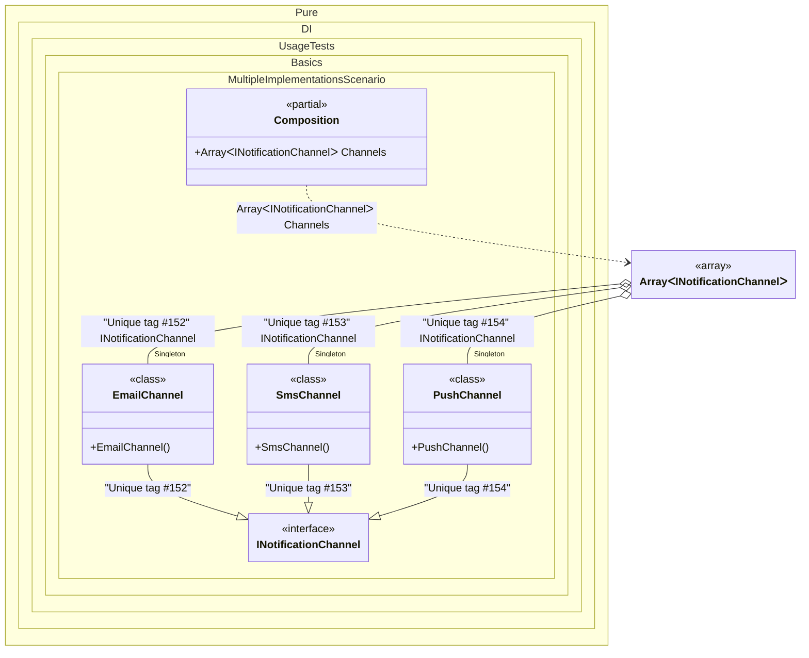

#### Multiple implementations

Use `To<T1, T2, ...>()` to bind several implementations to the same contract in one call. Each type becomes a separate binding with the configured lifetime and tags. Up to 64 implementation types are supported.
Use `Tag.Unique` when a collection should contain every implementation. Pure.DI assigns a distinct tag to each binding, so an array or `IEnumerable<T>` can collect them all.


```c#
using Shouldly;
using Pure.DI;

DI.Setup(nameof(Composition))
    // Each channel gets a separate binding with Singleton lifetime.
    .Bind<INotificationChannel>(Tag.Unique)
        .As(Lifetime.Singleton)
        .To<EmailChannel, SmsChannel, PushChannel>()
    .Root<INotificationChannel[]>("Channels");

var composition = new Composition();
var channels = composition.Channels;

channels.Length.ShouldBe(3);
channels[0].ShouldBeOfType<EmailChannel>();
channels[1].ShouldBeOfType<SmsChannel>();
channels[2].ShouldBeOfType<PushChannel>();

var channelsAgain = composition.Channels;
for (var index = 0; index < channels.Length; index++)
{
    channelsAgain[index].ShouldBeSameAs(channels[index]);
}

interface INotificationChannel;

class EmailChannel : INotificationChannel;

class SmsChannel : INotificationChannel;

class PushChannel : INotificationChannel;
```

<details>
<summary>Running this code sample locally</summary>

- Make sure you have the [.NET SDK 10.0](https://dotnet.microsoft.com/en-us/download/dotnet/10.0) or later installed
```bash
dotnet --list-sdk
```
- Create a net10.0 (or later) console application
```bash
dotnet new console -n Sample
```
- Add references to the NuGet packages
  - [Pure.DI](https://www.nuget.org/packages/Pure.DI)
  - [Shouldly](https://www.nuget.org/packages/Shouldly)
```bash
dotnet add package Pure.DI
dotnet add package Shouldly
```
- Copy the example code into the _Program.cs_ file

You are ready to run the example 🚀
```bash
dotnet run
```

</details>

You can use `Tag.Type` instead of `Tag.Unique` to give each binding the implementation type as its tag. For example, `EmailChannel` gets the tag `typeof(EmailChannel)`, which can also be used to resolve that implementation individually.
A regular shared tag follows the usual binding rules: later bindings for the same contract and tag override earlier ones, and the earlier one is reported as overridden. `Tag.Unique` keeps each implementation available to collection injection.
The lifetime applies to every type in the call, so `As(Lifetime.Singleton)` makes all three channels singletons of the same composition; bind them separately when their lifetimes differ.
The order of elements in the injected array or `IEnumerable<T>` follows the binding order, which makes a handler pipeline predictable.
Prefer `Tag.Unique` for plugin-style collections and explicit tags when the consumer must pick exactly one implementation.
See also: [Tag Type](tag-type.md), [Tag Unique](tag-unique.md), [Simplified lifetime-specific bindings](simplified-lifetime-specific-bindings.md).

<details>
<summary>The following partial class will be generated</summary>

```c#
partial class Composition
{
#if NET9_0_OR_GREATER
  private readonly Lock _lock = new Lock();
#else
  private readonly Object _lock = new Object();
#endif

  private EmailChannel? _singletonWcfLikeChannel;
  private SmsChannel? _singletonCompositionWithGenericRootsAndArgsInOtherProject;
  private PushChannel? _singletonNetworkDataSource;

  public INotificationChannel[] Channels
  {
    [MethodImpl(MethodImplOptions.AggressiveInlining)]
    get
    {
      if (_singletonWcfLikeChannel is null)
        lock (_lock)
          if (_singletonWcfLikeChannel is null)
          {
            _singletonWcfLikeChannel = new EmailChannel();
          }

      if (_singletonCompositionWithGenericRootsAndArgsInOtherProject is null)
        lock (_lock)
          if (_singletonCompositionWithGenericRootsAndArgsInOtherProject is null)
          {
            _singletonCompositionWithGenericRootsAndArgsInOtherProject = new SmsChannel();
          }

      if (_singletonNetworkDataSource is null)
        lock (_lock)
          if (_singletonNetworkDataSource is null)
          {
            _singletonNetworkDataSource = new PushChannel();
          }

      return new INotificationChannel[3]
      {
        _singletonWcfLikeChannel,
        _singletonCompositionWithGenericRootsAndArgsInOtherProject,
        _singletonNetworkDataSource
      };
    }
  }
}
```

</details>

Class diagram:



See also:

- [Tag Unique](tag-unique.md)
- [Tag Type](tag-type.md)
- [Simplified lifetime-specific bindings](simplified-lifetime-specific-bindings.md)

