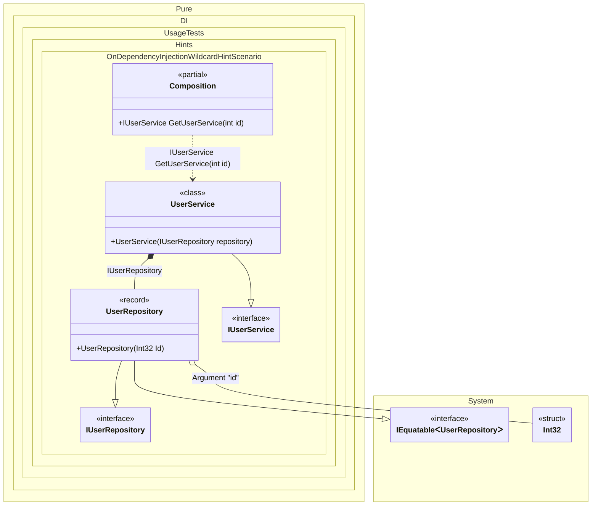

#### OnDependencyInjection wildcard hint

Hints are used to fine-tune code generation. The `OnDependencyInjection` hint determines whether to generate partial `OnDependencyInjection` method to control of dependency injection.
The wildcard filter is the practical choice in a codebase with naming conventions, because a few patterns such as `*IUserRepository` and `*IUserService` cover the seams you want to observe without listing concrete types.
In addition, setup hints can be comments before the `Setup` method in the form `hint = value`, for example: `// OnDependencyInjection = On`.


```c#
using Shouldly;
using Pure.DI;
using static Pure.DI.Hint;

// OnDependencyInjection = On
DI.Setup(nameof(Composition))
    .Hint(OnDependencyInjectionContractTypeNameWildcard, "*IUserRepository")
    .Hint(OnDependencyInjectionContractTypeNameWildcard, "*IUserService")
    .RootArg<int>("id")
    .Bind().To<UserRepository>()
    .Bind().To<UserService>()
    .Root<IUserService>("GetUserService");

var log = new List<string>();
var composition = new Composition(log);
var service = composition.GetUserService(33);

log.ShouldBe([
    "UserRepository injected",
    "UserService injected"
]);

interface IUserRepository;

record UserRepository(int Id) : IUserRepository;

interface IUserService
{
    IUserRepository Repository { get; }
}

class UserService(IUserRepository repository) : IUserService
{
    public IUserRepository Repository { get; } = repository;
}

partial class Composition(List<string> log)
{
    private partial T OnDependencyInjection<T>(
        in T value,
        object? tag,
        Lifetime lifetime)
    {
        log.Add($"{value?.GetType().Name} injected");
        return value;
    }
}
```

<details>
<summary>Running this code sample locally</summary>

- Make sure you have the [.NET SDK 10.0](https://dotnet.microsoft.com/en-us/download/dotnet/10.0) or later installed
```bash
dotnet --list-sdk
```
- Create a net10.0 (or later) console application
```bash
dotnet new console -n Sample
```
- Add references to the NuGet packages
  - [Pure.DI](https://www.nuget.org/packages/Pure.DI)
  - [Shouldly](https://www.nuget.org/packages/Shouldly)
```bash
dotnet add package Pure.DI
dotnet add package Shouldly
```
- Copy the example code into the _Program.cs_ file

You are ready to run the example 🚀
```bash
dotnet run
```

</details>

The `OnDependencyInjectionContractTypeNameWildcard` hint helps identify the set of types that require injection control. You can use it to specify a wildcard to filter the full name of a type.
Each hint call adds one pattern to the filter, and a type matching any of them is passed through the hook, so patterns accumulate instead of replacing each other.
The hook is partial and private: its signature is generated, and an accidental mismatch in it does not compile, which keeps the instrumentation honest.
Prefer the wildcard over the regular expression when the rule is "every type whose name ends with Service", and prefer explicit patterns over `*`, which would wrap every injection in the graph.
For more hints, see [this](../README.md#setup-hints) page.

<details>
<summary>The following partial class will be generated</summary>

```c#
partial class Composition
{
  [MethodImpl(MethodImplOptions.AggressiveInlining)]
  public IUserService GetUserService(int id)
  {
    return OnDependencyInjection<IUserService>(new UserService(OnDependencyInjection<IUserRepository>(new UserRepository(id), null, Lifetime.Transient)), null, Lifetime.Transient);
  }


  private partial T OnDependencyInjection<T>(in T value, object? tag, Lifetime lifetime);
}
```

</details>

Class diagram:



See also:

- [OnDependencyInjection regular expression hint](ondependencyinjection-regular-expression-hint.md)

