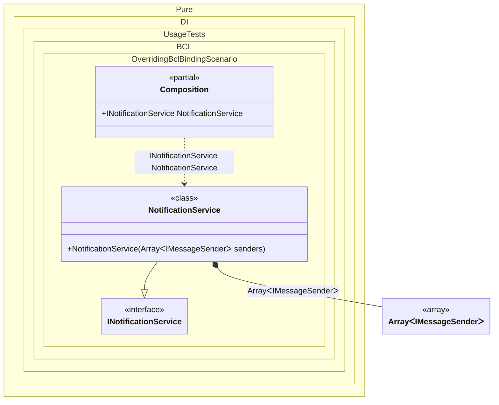

#### Overriding the BCL binding

At any time, the default binding to the BCL type can be changed to your own: a hand-written binding for a collection type replaces the one the generator creates from the individual bindings.


```c#
using Shouldly;
using Pure.DI;

DI.Setup(nameof(Composition))
    .Bind<IMessageSender[]>().To<IMessageSender[]>(() =>
        [new EmailSender(), new SmsSender(), new EmailSender()]
    )
    .Bind<INotificationService>().To<NotificationService>()

    // Composition root
    .Root<INotificationService>("NotificationService");

var composition = new Composition();
var notificationService = composition.NotificationService;
notificationService.Senders.Length.ShouldBe(3);
notificationService.Senders[0].ShouldBeOfType<EmailSender>();
notificationService.Senders[1].ShouldBeOfType<SmsSender>();
notificationService.Senders[2].ShouldBeOfType<EmailSender>();

interface IMessageSender;

class EmailSender : IMessageSender;

class SmsSender : IMessageSender;

interface INotificationService
{
    IMessageSender[] Senders { get; }
}

class NotificationService(IMessageSender[] senders) : INotificationService
{
    public IMessageSender[] Senders { get; } = senders;
}
```

<details>
<summary>Running this code sample locally</summary>

- Make sure you have the [.NET SDK 10.0](https://dotnet.microsoft.com/en-us/download/dotnet/10.0) or later installed
```bash
dotnet --list-sdk
```
- Create a net10.0 (or later) console application
```bash
dotnet new console -n Sample
```
- Add references to the NuGet packages
  - [Pure.DI](https://www.nuget.org/packages/Pure.DI)
  - [Shouldly](https://www.nuget.org/packages/Shouldly)
```bash
dotnet add package Pure.DI
dotnet add package Shouldly
```
- Copy the example code into the _Program.cs_ file

You are ready to run the example 🚀
```bash
dotnet run
```

</details>

>[!NOTE]
>Overriding BCL bindings allows you to provide custom implementations for standard types, enabling specialized behavior for your application.

A collection binding wins because it is more specific than the generated collection: the array here is built by the factory, so it decides the order, the length and even repeating one sender twice. That is how a pipeline gets an explicit sequence that individual bindings cannot express.
The override hides every individual binding of the same contract from that collection. If both are needed, keep the explicit array binding for the ordered pipeline and use a tagged collection parameter for the discovered set.
>[!TIP]
>Prefer overriding a BCL collection only when order or duplication must be fixed by hand; otherwise let the generator collect the bindings, so adding one cannot be forgotten.

<details>
<summary>The following partial class will be generated</summary>

```c#
partial class Composition
{
  public INotificationService NotificationService
  {
    [MethodImpl(MethodImplOptions.AggressiveInlining)]
    get
    {
      IMessageSender[] transient = [new EmailSender(), new SmsSender(), new EmailSender()];
      return new NotificationService(transient);
    }
  }
}
```

</details>

Class diagram:



See also:

- [Default BCL bindings](default-bcl-bindings.md)

