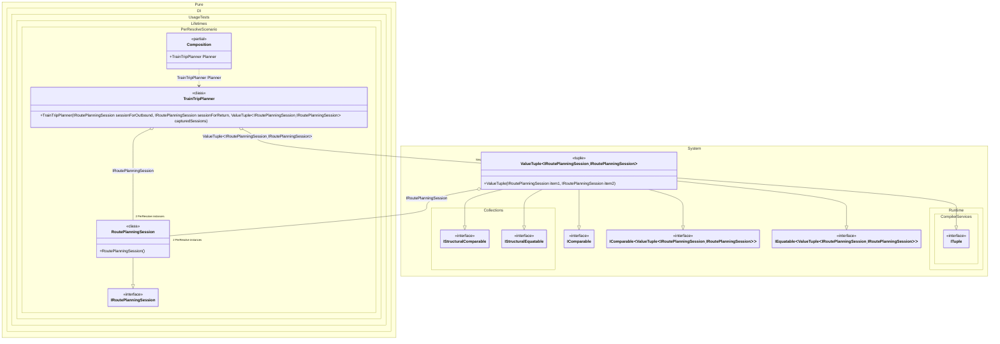

#### PerResolve

The `PerResolve` lifetime ensures that there will be one instance of the dependency for each composition root instance. Every access to a root starts a new resolution, so two accesses get two instances, while several injection sites inside one resolution get the same one.


```c#
using Shouldly;
using Pure.DI;
using static Pure.DI.Lifetime;

DI.Setup(nameof(Composition))
    // PerResolve = one "planning session" per root access.
    // Imagine: each time you ask for a plan, you get a fresh context.
    .Bind().As(PerResolve).To<RoutePlanningSession>()

    // Singleton = created once per Composition instance.
    // Here it intentionally captures session when it's created the first time
    // (this is a realistic pitfall: singleton accidentally holds request-scoped state).
    .Bind().As(Singleton).To<(IRoutePlanningSession s3, IRoutePlanningSession s4)>()

    // Composition root
    .Root<TrainTripPlanner>("Planner");

var composition = new Composition();

// First "user request": plan a trip now
var plan1 = composition.Planner;

// In the same request, PerResolve dependencies are the same instance:
plan1.SessionForOutbound.ShouldBe(plan1.SessionForReturn);

// Tuple is Singleton, so both entries are the same captured instance:
plan1.CapturedSessionA.ShouldBe(plan1.CapturedSessionB);

// Because the singleton tuple was created during the first request,
// it captured THAT request's PerResolve session:
plan1.SessionForOutbound.ShouldBe(plan1.CapturedSessionA);

// Second "user request": plan another trip (new root access)
var plan2 = composition.Planner;

// New request => new PerResolve session:
plan2.SessionForOutbound.ShouldNotBe(plan1.SessionForOutbound);

// But the singleton still holds the old captured session from the first request:
plan2.CapturedSessionA.ShouldBe(plan1.CapturedSessionA);
plan2.SessionForOutbound.ShouldNotBe(plan2.CapturedSessionA);

// A request-scoped context: e.g., contains "now", locale, pricing rules version,
// feature flags, etc. You typically want a new one per route planning request.
interface IRoutePlanningSession;

class RoutePlanningSession : IRoutePlanningSession;

// A service that plans a train trip.
// It asks for two session instances to demonstrate PerResolve:
// both should be the same within a single request.
class TrainTripPlanner(
    IRoutePlanningSession sessionForOutbound,
    IRoutePlanningSession sessionForReturn,
    (IRoutePlanningSession capturedA, IRoutePlanningSession capturedB) capturedSessions)
{
    public IRoutePlanningSession SessionForOutbound { get; } = sessionForOutbound;

    public IRoutePlanningSession SessionForReturn { get; } = sessionForReturn;

    // These come from a singleton tuple - effectively "global cached" instances.
    public IRoutePlanningSession CapturedSessionA { get; } = capturedSessions.capturedA;

    public IRoutePlanningSession CapturedSessionB { get; } = capturedSessions.capturedB;
}
```

<details>
<summary>Running this code sample locally</summary>

- Make sure you have the [.NET SDK 10.0](https://dotnet.microsoft.com/en-us/download/dotnet/10.0) or later installed
```bash
dotnet --list-sdk
```
- Create a net10.0 (or later) console application
```bash
dotnet new console -n Sample
```
- Add references to the NuGet packages
  - [Pure.DI](https://www.nuget.org/packages/Pure.DI)
  - [Shouldly](https://www.nuget.org/packages/Shouldly)
```bash
dotnet add package Pure.DI
dotnet add package Shouldly
```
- Copy the example code into the _Program.cs_ file

You are ready to run the example 🚀
```bash
dotnet run
```

</details>

>[!NOTE]
>`PerResolve` lifetime is useful when you want to share a dependency instance within a single composition root resolution.

Reach for it when one operation needs a consistent collaborator - a pricing session, a request-scoped counter, a set of rules evaluated once - but that collaborator must not outlive the operation or be shared between operations.
The scope is the root access itself, so a `PerResolve` instance is not disposed by the composition and is not visible to code that resolved the graph earlier. If the reuse boundary must be something the application can name and end, use `Scoped`; if it must live as long as the composition, use `Singleton`.
>[!WARNING]
>The scenario deliberately shows the common mistake: a `Singleton` tuple requests the `PerResolve` dependency, so it captures the instance created during the first resolution and keeps it forever. Inspect every singleton for `PerResolve`, `Scoped` and `Transient` dependencies before shipping.

See [PerBlock](perblock.md) when reuse should stay inside one construction block instead of the whole root.

<details>
<summary>The following partial class will be generated</summary>

```c#
partial class Composition
{
#if NET9_0_OR_GREATER
  private readonly Lock _lock = new Lock();
#else
  private readonly Object _lock = new Object();
#endif

  private (IRoutePlanningSession s3, IRoutePlanningSession s4) _singletonValueTuple1;
  private bool _singletonValueTuple1Created;

  public TrainTripPlanner Planner
  {
    [MethodImpl(MethodImplOptions.AggressiveInlining)]
    get
    {
      var perResolveRoutePlanningSession = default(RoutePlanningSession);
      if (!_singletonValueTuple1Created)
        lock (_lock)
          if (!_singletonValueTuple1Created)
          {
            if (perResolveRoutePlanningSession is null)
            {
              perResolveRoutePlanningSession = new RoutePlanningSession();
            }

            _singletonValueTuple1 = (perResolveRoutePlanningSession, perResolveRoutePlanningSession);
            Thread.MemoryBarrier();
            _singletonValueTuple1Created = true;
          }

      if (perResolveRoutePlanningSession is null)
        lock (_lock)
          if (perResolveRoutePlanningSession is null)
          {
            perResolveRoutePlanningSession = new RoutePlanningSession();
          }

      return new TrainTripPlanner(perResolveRoutePlanningSession, perResolveRoutePlanningSession, _singletonValueTuple1);
    }
  }
}
```

</details>

Class diagram:



See also:

- [Transient](transient.md)
- [PerBlock](perblock.md)
- [Singleton](singleton.md)

