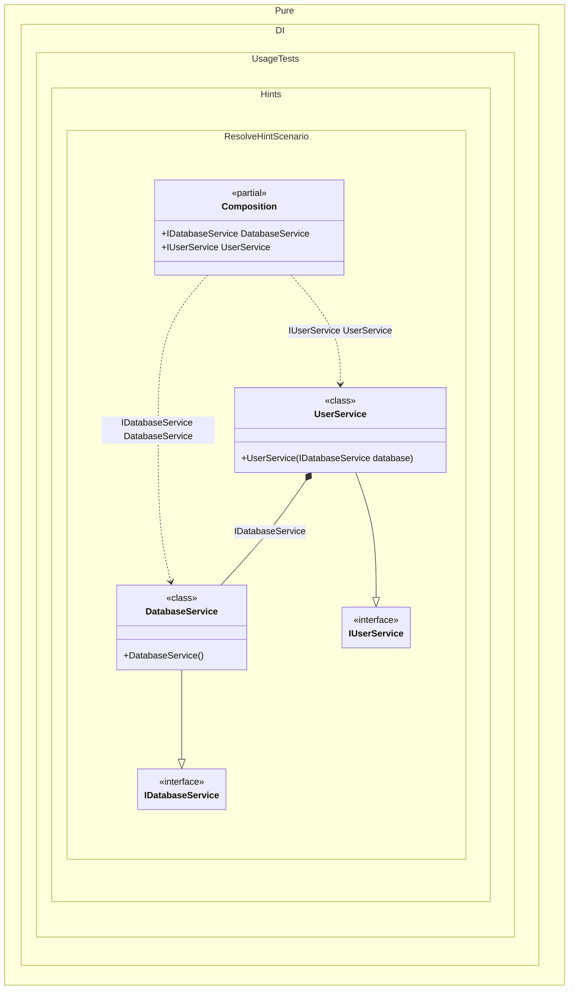

#### Resolve hint

Hints fine-tune code generation. The `Resolve` hint decides whether the composition gets dynamic entry points: `Resolve<T>()`, `Resolve(Type)` and their tagged overloads, four members in total, generated by default.
Set it to `Off` when a composition exposes named roots only, which is the usual setting for an application: generation gets cheaper, no anonymous roots are emitted, and the public API of the composition stays limited to the members you declared. Only regular root properties and methods remain, so declare every entry point with `Root<T>(...)`.
Keep it `On` for a host that resolves types it learns about at runtime, such as a plugin or script host, and for exploratory tests. A hint can also be a comment before `Setup`: `// Resolve = Off`.


```c#
using Pure.DI;
using static Pure.DI.Hint;

DI.Setup(nameof(Composition))
    .Hint(Resolve, "Off")
    .Bind().To<DatabaseService>()
    // When the "Resolve" hint is disabled, only the regular root properties
    // are available, so be sure to define them explicitly
    // with the "Root<T>(...)" method.
    .Root<IDatabaseService>("DatabaseService")
    .Bind().To<UserService>()
    .Root<IUserService>("UserService");

var composition = new Composition();

// The "Resolve" method is not generated,
// so we can only access the roots through properties:
var userService = composition.UserService;
var databaseService = composition.DatabaseService;

// composition.Resolve<IUserService>(); // Compile error

interface IDatabaseService;

class DatabaseService : IDatabaseService;

interface IUserService;

class UserService(IDatabaseService database) : IUserService;
```

<details>
<summary>Running this code sample locally</summary>

- Make sure you have the [.NET SDK 10.0](https://dotnet.microsoft.com/en-us/download/dotnet/10.0) or later installed
```bash
dotnet --list-sdk
```
- Create a net10.0 (or later) console application
```bash
dotnet new console -n Sample
```
- Add a reference to the NuGet package
  - [Pure.DI](https://www.nuget.org/packages/Pure.DI)
```bash
dotnet add package Pure.DI
```
- Copy the example code into the _Program.cs_ file

You are ready to run the example 🚀
```bash
dotnet run
```

</details>

In a real project the hint belongs to the composition in the startup or integration assembly; a library usually ships bindings and lets the application decide.
A root that needs a root argument cannot be produced by a `Resolve` method. Pure.DI still generates the methods and reports a warning, so prefer `// Resolve = Off` in such compositions instead of living with it.
With the hint `Off`, an unnamed `Root<T>()` is not emitted at all, and an unused private root is easy to miss because nothing fails to compile.
`Resolve` for a type with no root throws `CannotResolveException` at runtime, so the safety of a `Resolve` call is exactly the root list behind it.
Prefer named roots whenever the entry points are known at compile time; [Resolve methods](resolve-methods.md) shows what the dynamic path costs.
For more hints, see [this](../README.md#setup-hints) page.

<details>
<summary>The following partial class will be generated</summary>

```c#
partial class Composition
{
  public IDatabaseService DatabaseService
  {
    [MethodImpl(MethodImplOptions.AggressiveInlining)]
    get
    {
      return new DatabaseService();
    }
  }

  public IUserService UserService
  {
    [MethodImpl(MethodImplOptions.AggressiveInlining)]
    get
    {
      return new UserService(new DatabaseService());
    }
  }
}
```

</details>

Class diagram:



See also:

- [Resolve methods](resolve-methods.md)
- [Check for a root](check-for-a-root.md)

