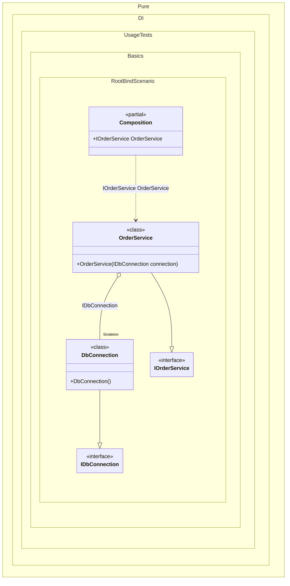

#### Root binding

`RootBind<T>(rootName)` is a shorthand that declares a binding and a composition root in one call, for the case where a type is both the entry point and something other services depend on.
It removes the repetition in `Bind<IDependency>().To<Dependency>().Root<IDependency>()`, which matters in compositions that expose several entry points.


```c#
using Shouldly;
using Pure.DI;

DI.Setup(nameof(Composition))
    .Bind().As(Lifetime.Singleton).To<DbConnection>()
    // RootBind lets you define a binding and a composition root
    // simultaneously. This is useful for creating public entry points
    // for your application components while keeping the configuration concise.
    .RootBind<IOrderService>("OrderService").To<OrderService>();

// The line above is functionally equivalent to:
//  .Bind<IOrderService>().To<OrderService>()
//  .Root<IOrderService>("OrderService")

var composition = new Composition();
var orderService = composition.OrderService;
orderService.ShouldBeOfType<OrderService>();

interface IDbConnection;

class DbConnection : IDbConnection;

interface IOrderService;

class OrderService(IDbConnection connection) : IOrderService;
```

<details>
<summary>Running this code sample locally</summary>

- Make sure you have the [.NET SDK 10.0](https://dotnet.microsoft.com/en-us/download/dotnet/10.0) or later installed
```bash
dotnet --list-sdk
```
- Create a net10.0 (or later) console application
```bash
dotnet new console -n Sample
```
- Add references to the NuGet packages
  - [Pure.DI](https://www.nuget.org/packages/Pure.DI)
  - [Shouldly](https://www.nuget.org/packages/Shouldly)
```bash
dotnet add package Pure.DI
dotnet add package Shouldly
```
- Copy the example code into the _Program.cs_ file

You are ready to run the example 🚀
```bash
dotnet run
```

</details>

The call returns a binding builder, so `.To<TImpl>()`, `.As(Lifetime.Singleton)` and tags are chained exactly as on `Bind<T>()`.
The root name is a member name on the composition, so it must be a valid identifier and unique among roots (`DIE004`, `DIE005`).
The root exposes the contract, not the implementation: keep `RootBind<IOrderService>` so the caller sees the abstraction and can be given a decorator later.
Prefer the explicit `Bind(...).Root(...)` pair when the binding and the root deliberately differ in type or tag; `RootBind` is for the identical case only.

<details>
<summary>The following partial class will be generated</summary>

```c#
partial class Composition
{
#if NET9_0_OR_GREATER
  private readonly Lock _lock = new Lock();
#else
  private readonly Object _lock = new Object();
#endif

  private DbConnection? _singletonWcfLikeChannel;

  public IOrderService OrderService
  {
    [MethodImpl(MethodImplOptions.AggressiveInlining)]
    get
    {
      if (_singletonWcfLikeChannel is null)
        lock (_lock)
          if (_singletonWcfLikeChannel is null)
          {
            _singletonWcfLikeChannel = new DbConnection();
          }

      return new OrderService(_singletonWcfLikeChannel);
    }
  }
}
```

</details>

Class diagram:



See also:

- [Composition roots](composition-roots.md)

