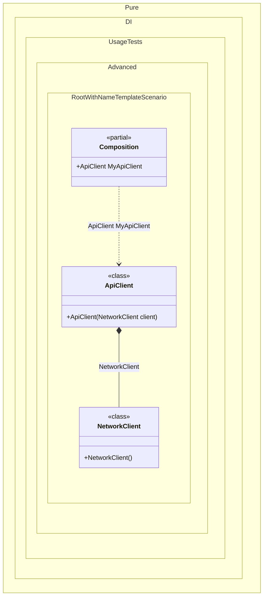

#### Root with name template

Instead of a fixed root name, `Root<T>()` accepts a name template where the `{type}` placeholder is replaced with the dependency's type name; `{TYPE}` gives the fully qualified name and `{tag}` the first root tag. This is handy when you declare many roots and want them to follow a consistent naming convention: the template `"My{type}"` here produces a root property named `MyApiClient`.
The result is made a valid C# identifier, so a generic type name is usable in a template.


```c#
using Shouldly;
using Pure.DI;

DI.Setup("Composition")
    // The name template "My{type}" specifies that the root property name
    // will be formed by adding the prefix "My" to the type name "ApiClient".
    .Root<ApiClient>("My{type}");

var composition = new Composition();

// The property name is "MyApiClient" instead of "ApiClient"
// thanks to the name template "My{type}"
var apiClient = composition.MyApiClient;

apiClient.GetProfile().ShouldBe("Content from https://example.com/profile");

class NetworkClient
{
    public string Get(string uri) => $"Content from {uri}";
}

class ApiClient(NetworkClient client)
{
    public string GetProfile() => client.Get("https://example.com/profile");
}
```

<details>
<summary>Running this code sample locally</summary>

- Make sure you have the [.NET SDK 10.0](https://dotnet.microsoft.com/en-us/download/dotnet/10.0) or later installed
```bash
dotnet --list-sdk
```
- Create a net10.0 (or later) console application
```bash
dotnet new console -n Sample
```
- Add references to the NuGet packages
  - [Pure.DI](https://www.nuget.org/packages/Pure.DI)
  - [Shouldly](https://www.nuget.org/packages/Shouldly)
```bash
dotnet add package Pure.DI
dotnet add package Shouldly
```
- Copy the example code into the _Program.cs_ file

You are ready to run the example 🚀
```bash
dotnet run
```

</details>

Use it with `Roots<T>("Root{type}")` ([roots with filter](roots-with-filter.md)) when the same convention must cover many types, so adding a type does not mean adding a hand-written root.
The generated name is part of the public API: changing the template renames members for every consumer, so treat it like any other breaking change.
Two templates that resolve to the same name are reported as `DIE005`.
>[!NOTE]
>Name templates provide flexibility in root naming but should be used consistently to maintain code readability.

Prefer an explicit name when the root is part of a contract consumed by other code, and a template for the mechanically generated set.

<details>
<summary>The following partial class will be generated</summary>

```c#
partial class Composition
{
  public ApiClient MyApiClient
  {
    [MethodImpl(MethodImplOptions.AggressiveInlining)]
    get
    {
      return new ApiClient(new NetworkClient());
    }
  }
}
```

</details>

Class diagram:



See also:

- [Composition roots](composition-roots.md)

