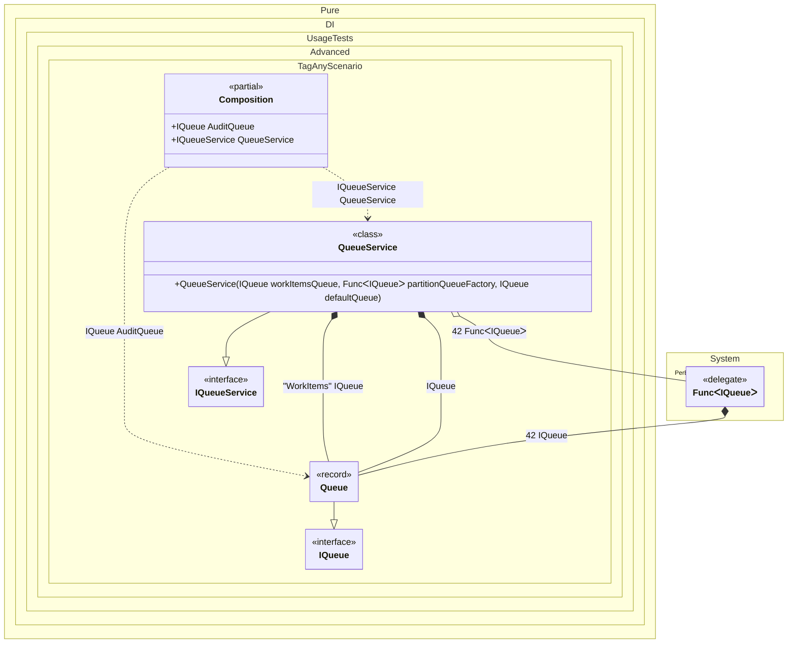

#### Tag Any

`Tag.Any` creates a binding that matches any tag value, including default (null), allowing flexible injection scenarios where the tag value can be used within factory contexts. This is useful when you need to dynamically handle different tag values in a single binding.
Inside the factory, `ctx.Tag` gives the tag the consumer asked for, so one catch-all binding can create a family of tagged instances.


```c#
using Shouldly;
using Pure.DI;

DI.Setup(nameof(Composition))
    // Binds IQueue to the Queue implementation.
    // Tag.Any creates a binding that matches any tag (including null),
    // allowing the specific tag value to be used within the factory (ctx.Tag).
    .Bind<IQueue>(Tag.Any).To(ctx => new Queue(ctx.Tag))
    .Bind<IQueueService>().To<QueueService>()

    // Composition root
    .Root<IQueueService>("QueueService")

    // Root by Tag.Any: Resolves IQueue with the tag "Audit"
    .Root<IQueue>("AuditQueue", "Audit");

var composition = new Composition();
var queueService = composition.QueueService;

queueService.WorkItemsQueue.Id.ShouldBe("WorkItems");
queueService.PartitionQueue.Id.ShouldBe(42);
queueService.DefaultQueue.Id.ShouldBeNull();
composition.AuditQueue.Id.ShouldBe("Audit");

interface IQueue
{
    object? Id { get; }
}

record Queue(object? Id) : IQueue;

interface IQueueService
{
    IQueue WorkItemsQueue { get; }

    IQueue PartitionQueue { get; }

    IQueue DefaultQueue { get; }
}

class QueueService(
    // Injects IQueue tagged with "WorkItems"
    [Tag("WorkItems")] IQueue workItemsQueue,
    // Injects IQueue tagged with integer 42
    [Tag(42)] Func<IQueue> partitionQueueFactory,
    // Injects IQueue with the default (null) tag
    IQueue defaultQueue)
    : IQueueService
{
    public IQueue WorkItemsQueue { get; } = workItemsQueue;

    public IQueue PartitionQueue { get; } = partitionQueueFactory();

    public IQueue DefaultQueue { get; } = defaultQueue;
}
```

<details>
<summary>Running this code sample locally</summary>

- Make sure you have the [.NET SDK 10.0](https://dotnet.microsoft.com/en-us/download/dotnet/10.0) or later installed
```bash
dotnet --list-sdk
```
- Create a net10.0 (or later) console application
```bash
dotnet new console -n Sample
```
- Add references to the NuGet packages
  - [Pure.DI](https://www.nuget.org/packages/Pure.DI)
  - [Shouldly](https://www.nuget.org/packages/Shouldly)
```bash
dotnet add package Pure.DI
dotnet add package Shouldly
```
- Copy the example code into the _Program.cs_ file

You are ready to run the example 🚀
```bash
dotnet run
```

</details>

This is how one implementation serves several keyed consumers - queue per partition, client per environment - without repeating a `.Bind()` line per key.
Because the binding matches every tag, an injection you expected to be served by a default binding ends up here: read the generated code or the class diagram after adding a catch-all binding.
A `Tag.Any` binding does not replace an explicit one for the same contract when the consumer must keep a specific tag; keep explicit bindings for contracts that are part of a published API.
>[!IMPORTANT]
>`Tag.Any` provides maximum flexibility but requires careful handling within factories to properly interpret and use the tag value.

Prefer distinct keys such as an enum or `Tag.Type` when the set of tags is known at compile time, because they keep the graph readable and let the generator validate every injection.

<details>
<summary>The following partial class will be generated</summary>

```c#
partial class Composition
{
  public IQueue AuditQueue
  {
    [MethodImpl(MethodImplOptions.AggressiveInlining)]
    get
    {
      Queue transientQueue = new Queue("Audit");
      return transientQueue;
    }
  }

  public IQueueService QueueService
  {
    [MethodImpl(MethodImplOptions.AggressiveInlining)]
    get
    {
      Queue transientQueue = new Queue("WorkItems");
      Queue transientQueue1 = new Queue(null);
      Func<IQueue> perBlockFuncIQueue = new Func<IQueue>(
      [MethodImpl(MethodImplOptions.AggressiveInlining)]
      () =>
      {
        // Creates a deferred value
        Queue transientQueue2 = new Queue(42);
        return transientQueue2;
      });
      return new QueueService(transientQueue, perBlockFuncIQueue, transientQueue1);
    }
  }
}
```

</details>

Class diagram:



See also:

- [Tags](tags.md)

