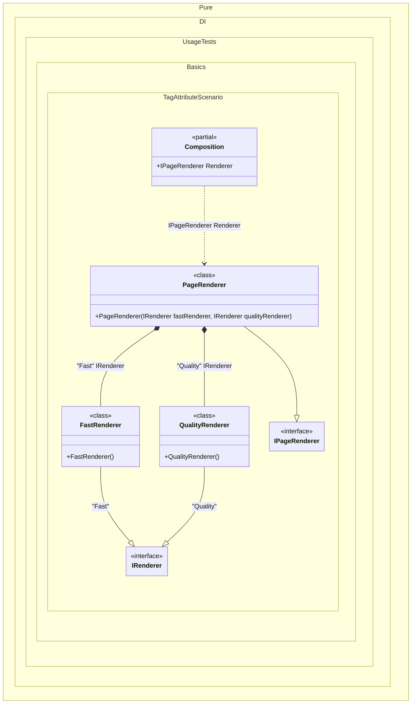

#### Tag attribute

Tags let you choose among multiple implementations of the same contract. `[Tag(...)]` places that choice at the injection site, so the consuming type states which implementation it needs while the composition still owns the bindings. Use it when one class legitimately depends on two implementations of the same interface, as `PageRenderer` does with a fast and a quality renderer.


```c#
using Shouldly;
using Pure.DI;

DI.Setup(nameof(Composition))
    .Bind("Fast").To<FastRenderer>()
    .Bind("Quality").To<QualityRenderer>()
    .Bind().To<PageRenderer>()

    // Composition root
    .Root<IPageRenderer>("Renderer");

var composition = new Composition();
var pageRenderer = composition.Renderer;
pageRenderer.FastRenderer.ShouldBeOfType<FastRenderer>();
pageRenderer.QualityRenderer.ShouldBeOfType<QualityRenderer>();

interface IRenderer;

class FastRenderer : IRenderer;

class QualityRenderer : IRenderer;

interface IPageRenderer
{
    IRenderer FastRenderer { get; }

    IRenderer QualityRenderer { get; }
}

class PageRenderer(
    [Tag("Fast")] IRenderer fastRenderer,
    [Tag("Quality")] IRenderer qualityRenderer)
    : IPageRenderer
{
    public IRenderer FastRenderer { get; } = fastRenderer;

    public IRenderer QualityRenderer { get; } = qualityRenderer;
}
```

<details>
<summary>Running this code sample locally</summary>

- Make sure you have the [.NET SDK 10.0](https://dotnet.microsoft.com/en-us/download/dotnet/10.0) or later installed
```bash
dotnet --list-sdk
```
- Create a net10.0 (or later) console application
```bash
dotnet new console -n Sample
```
- Add references to the NuGet packages
  - [Pure.DI](https://www.nuget.org/packages/Pure.DI)
  - [Shouldly](https://www.nuget.org/packages/Shouldly)
```bash
dotnet add package Pure.DI
dotnet add package Shouldly
```
- Copy the example code into the _Program.cs_ file

You are ready to run the example 🚀
```bash
dotnet run
```

</details>

This is the usual way to keep an implementation choice next to the consumer when the consumer's code is yours: the setup binds each implementation once with its tag, and every injection site picks one of them. A codebase with many tags usually replaces string literals with an enum or a [smart tag](smart-tags.md), so a mistyped tag cannot compile.
A tag that matches no binding leaves the contract unresolved, and Pure.DI reports that at compile time instead of failing at run time. The tag is part of the injection-site contract, so renaming one touches the setup and every consumer in the same change.
A tag can be a constant, a type, a [smart tag](smart-tags.md), or an enum value. The `Tag` attribute is part of the API, but you can define your own in any assembly or namespace.
>[!TIP]
>Prefer enum values or smart tags once a graph has more than a couple of string tags, and reserve `[Tag("...")]` for small graphs where the literal is obvious.

<details>
<summary>The following partial class will be generated</summary>

```c#
partial class Composition
{
  public IPageRenderer Renderer
  {
    [MethodImpl(MethodImplOptions.AggressiveInlining)]
    get
    {
      return new PageRenderer(new FastRenderer(), new QualityRenderer());
    }
  }
}
```

</details>

Class diagram:



See also:

- [Tags](tags.md)
- [Smart tags](smart-tags.md)

