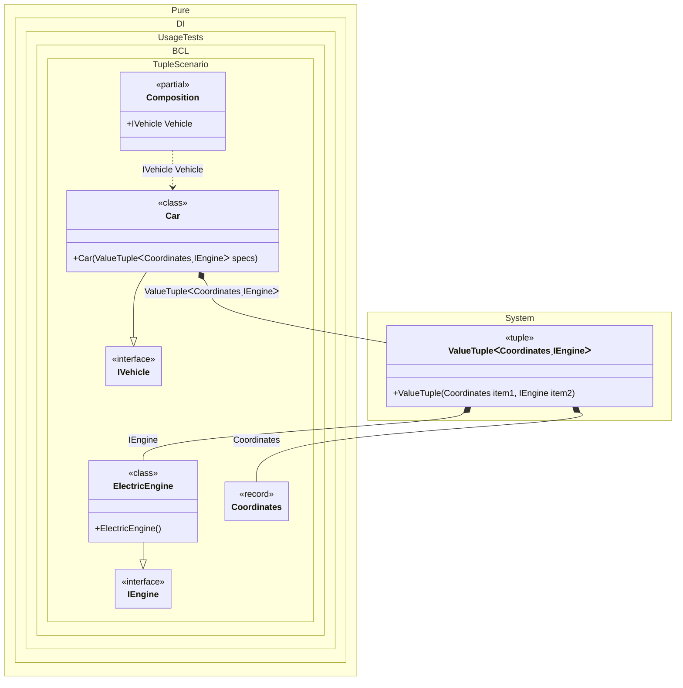

#### Tuple

The tuples feature provides concise syntax to group multiple data elements in a lightweight data structure. The following example shows how a type can ask to inject a tuple argument into it: each element is resolved as its own contract, so `Coordinates` and `IEngine` are injected into one constructor parameter.


```c#
using Shouldly;
using Pure.DI;

DI.Setup(nameof(Composition))
    .Bind<IEngine>().To<ElectricEngine>()
    .Bind<Coordinates>().To(() => new Coordinates(10, 20))
    .Bind<IVehicle>().To<Car>()

    // Composition root
    .Root<IVehicle>("Vehicle");

var composition = new Composition();
var vehicle = composition.Vehicle;

interface IEngine;

class ElectricEngine : IEngine;

readonly record struct Coordinates(int X, int Y);

interface IVehicle
{
    IEngine Engine { get; }
}

class Car((Coordinates StartPosition, IEngine Engine) specs) : IVehicle
{
    // The tuple 'specs' groups the initialization data (like coordinates)
    // and dependencies (like engine) into a single lightweight argument.
    public IEngine Engine { get; } = specs.Engine;
}
```

<details>
<summary>Running this code sample locally</summary>

- Make sure you have the [.NET SDK 10.0](https://dotnet.microsoft.com/en-us/download/dotnet/10.0) or later installed
```bash
dotnet --list-sdk
```
- Create a net10.0 (or later) console application
```bash
dotnet new console -n Sample
```
- Add references to the NuGet packages
  - [Pure.DI](https://www.nuget.org/packages/Pure.DI)
  - [Shouldly](https://www.nuget.org/packages/Shouldly)
```bash
dotnet add package Pure.DI
dotnet add package Shouldly
```
- Copy the example code into the _Program.cs_ file

You are ready to run the example 🚀
```bash
dotnet run
```

</details>

>[!NOTE]
>Tuples are useful for returning multiple values from a method or grouping related dependencies without creating explicit types.

The elements are resolved independently by type, which means a tuple is not a contract: you cannot bind a tuple as a whole or tag it per element. Use it to keep a constructor short when several values belong together semantically, such as a start position and a motor.
Because a tuple carries no name, two dependencies of the same type inside one tuple would both resolve to the same binding. Prefer an explicit type or tags once the grouping needs identity.
>[!TIP]
>Prefer a small record when the group is used in more than one place or needs validation; a tuple is best for a single constructor parameter.

<details>
<summary>The following partial class will be generated</summary>

```c#
partial class Composition
{
  public IVehicle Vehicle
  {
    [MethodImpl(MethodImplOptions.AggressiveInlining)]
    get
    {
      Coordinates transientCoordinates = new Coordinates(10, 20);
      return new Car((transientCoordinates, new ElectricEngine()));
    }
  }
}
```

</details>

Class diagram:



