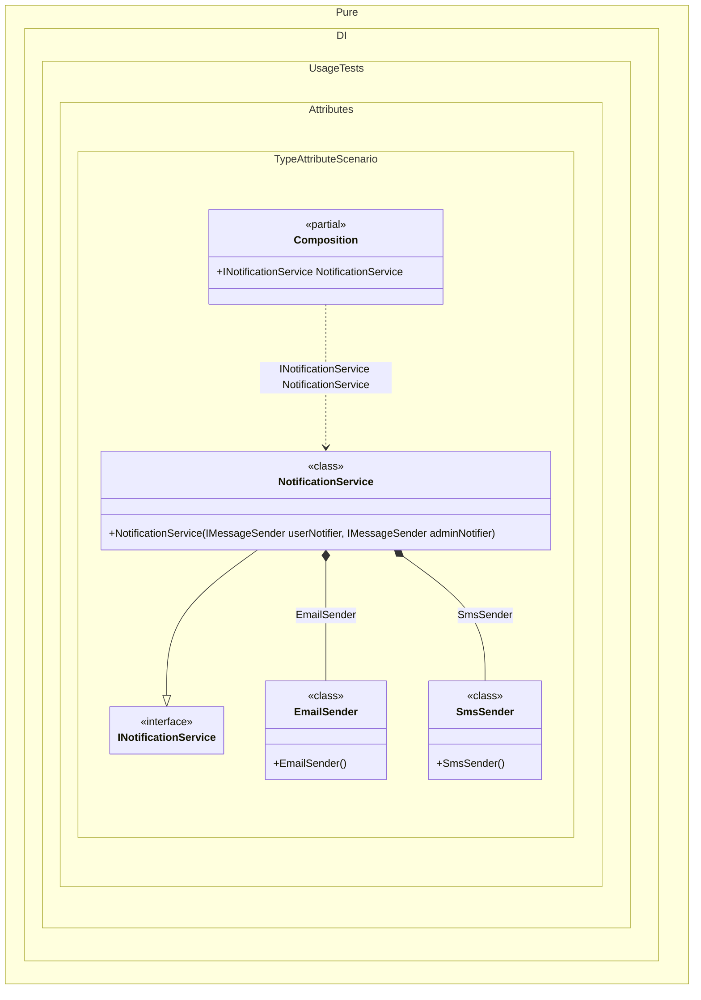

#### Type attribute

Use the `Type` attribute to force a specific injected type, overriding the inferred type from the parameter or member. It fits when one class takes two dependencies of the same interface and each parameter must receive a different implementation, which the composition cannot tell apart by type alone.


```c#
using Shouldly;
using Pure.DI;

DI.Setup(nameof(Composition))
    .Bind().To<NotificationService>()

    // Composition root
    .Root<INotificationService>("NotificationService");

var composition = new Composition();
var notificationService = composition.NotificationService;
notificationService.UserNotifier.ShouldBeOfType<EmailSender>();
notificationService.AdminNotifier.ShouldBeOfType<SmsSender>();

interface IMessageSender;

class EmailSender : IMessageSender;

class SmsSender : IMessageSender;

interface INotificationService
{
    IMessageSender UserNotifier { get; }

    IMessageSender AdminNotifier { get; }
}

class NotificationService(
    // The [Type] attribute forces the injection of a specific type,
    // overriding the default resolution behavior.
    [Type(typeof(EmailSender))] IMessageSender userNotifier,
    [Type(typeof(SmsSender))] IMessageSender adminNotifier)
    : INotificationService
{
    public IMessageSender UserNotifier { get; } = userNotifier;

    public IMessageSender AdminNotifier { get; } = adminNotifier;
}
```

<details>
<summary>Running this code sample locally</summary>

- Make sure you have the [.NET SDK 10.0](https://dotnet.microsoft.com/en-us/download/dotnet/10.0) or later installed
```bash
dotnet --list-sdk
```
- Create a net10.0 (or later) console application
```bash
dotnet new console -n Sample
```
- Add references to the NuGet packages
  - [Pure.DI](https://www.nuget.org/packages/Pure.DI)
  - [Shouldly](https://www.nuget.org/packages/Shouldly)
```bash
dotnet add package Pure.DI
dotnet add package Shouldly
```
- Copy the example code into the _Program.cs_ file

You are ready to run the example 🚀
```bash
dotnet run
```

</details>

Because `[Type(typeof(...))]` names the implementation at the injection site, a type can say "this parameter needs a sender by e-mail, not just any sender" without adding a tag to the setup. Keep it for cases where the concrete type really is part of the contract, such as an adapter that must talk to one specific transport.
The attribute overrides type inference, so the setup stops deciding which implementation arrives here: binding `IMessageSender` differently will not affect these parameters. It also couples the consumer to the implementation type, which erodes the abstraction if it spreads beyond a few intentional places.
The `Type` attribute is part of the API, but you can define your own in any assembly or namespace.
>[!TIP]
>Prefer [tags](tag-attribute.md) when the choice should stay in the composition, and use `[Type]` when the consumer itself must pin one implementation.

<details>
<summary>The following partial class will be generated</summary>

```c#
partial class Composition
{
  public INotificationService NotificationService
  {
    [MethodImpl(MethodImplOptions.AggressiveInlining)]
    get
    {
      return new NotificationService(new EmailSender(), new SmsSender());
    }
  }
}
```

</details>

Class diagram:



